# 算法与系统设计与实现

## 第3章 防碰约束下的待钻井眼轨道再规划方法

### 3.1 引言

丛式井和水平井施工中，实钻轨迹会受到地层倾角、钻具组合、定向工具响应及测量误差的共同影响。当实际井底偏离原设计轨道，或者待钻井段接近已钻邻井时，继续沿用原方案可能无法兼顾中靶要求与井间安全距离。再规划的任务是在保留已钻井段的基础上，以最新可信井底状态为起点，在工具造斜能力、井段长度和井间防碰约束下，重新确定到达目标的待钻轨道。

已有研究将待钻轨道表示为若干空间圆弧段及稳斜段，并以轨道长度最小化建立约束优化模型[1]。这一表示能够将连续空间曲线转化为有限维控制参数，同时保留井斜、方位及井眼曲率的工程意义。本文采用这一建模思路，以提供的轨迹优化计算程序为数值基础，将最小曲率轨道递推、测量不确定性传播和分离系数约束组合为统一的再规划问题。默认采用序列二次规划方法求解，并保留其他约束优化器，用于相同模型条件下的比较。

本章的算法对象为轨迹再规划。测斜归算是轨道状态的计算基础，防碰评价为规划提供约束及复核依据，姿态预测提供可选择的前瞻状态，三者不分别作为本文新提出的研究算法。后续章节进一步讨论这些能力如何在实时钻井系统中组织和使用。

### 3.2 轨道再规划问题描述

#### 3.2.1 坐标体系与起始状态

采用北—东—垂深坐标系，位置向量记为 $\boldsymbol p=(N,E,D)^{\mathrm T}$，其中垂深 $D$ 向下为正。井斜角 $I$ 从铅垂向下方向起算，方位角 $A$ 从网格北起顺时针计量。轨道切向单位向量为

$$
\boldsymbol t(I,A)=
\begin{bmatrix}
\sin I\cos A\\
\sin I\sin A\\
\cos I
\end{bmatrix}. \tag{3-1}
$$

井底起始状态由位置、姿态和测深共同确定，记为 $\boldsymbol s_0=(\boldsymbol p_0,I_0,A_0,MD_0)$。实际计算时，起点绑定到选定实钻测斜版本的最后一个测点，不能由浏览器另行提交一个不属于该版本的坐标。已钻轨迹构成固定历史，不参与待钻轨道控制变量的优化。历史测点同时用于测量误差传播，使规划起点继承已有井段累积的不确定性，而不是在井底重新从零开始计算误差。

跨井比较前，测深和坐标统一为米，角度统一为度，方位统一到同一网格北。磁偏角、子午线收敛角及垂向基准的处理均保留在版本参考信息中。具有不同投影坐标系的轨迹先进行坐标转换；缺少跨坐标系转换依据时，应返回明确错误，而不能直接将数值相近的坐标视为同一位置。

#### 3.2.2 再规划输入与输出

再规划输入包括起点状态、目标点或目标盒、邻井测斜版本、段式模型、工程约束和不确定性参数。目标既可以只要求位置中靶，也可以进一步限定终点井斜角和方位角。未要求终点姿态时，应放宽对应约束，而不能默认把起点姿态当成用户指定的终点姿态。

表3-1给出主要物理量的定义。符号中的曲率 $\kappa$ 与不确定性放大系数 $K$ 分别属于轨道几何和误差评价两个不同概念。

**表3-1 再规划问题中的主要物理量**

|符号|物理意义|单位|
|---|---|---|
|$MD_0$|实钻版本末测点测深|m|
|$\boldsymbol p_0,\boldsymbol p_T$|当前井底位置、目标位置|m|
|$I,A$|井斜角、网格方位角|°|
|$L_i$|第 $i$ 段待钻井段长度|m|
|$q_i$|第 $i$ 段狗腿度|°/30 m|
|$\kappa_i$|第 $i$ 段空间曲率|1/m|
|$\omega_i$|第 $i$ 段起始工具面角|°|
|$\boldsymbol C(s)$|沿轨迹的位置协方差矩阵|m²|
|$K$|不确定性放大系数|无量纲|
|$SF_{\min}$|允许的最低分离系数|无量纲|

输出包括待钻轨道总长、终点位置误差、逐段控制参数、按测深采样的轨道表，以及约束是否满足的审查结果。若未获得通过复核的可行方案，应报告本次搜索失败及其原因，不得将最后一次迭代值作为已经通过工程约束的方案，也不得据此宣称该问题在数学上无解。

#### 3.2.3 邻井范围与轨道版本

井、井眼和轨迹版本具有不同的物理含义。一口井可以存在主井眼、侧钻井眼等多个空间分支，每个井眼又可以存在多次实钻测量和设计修订。防碰障碍物应对应一个确定井眼的确定轨迹版本，不能将一口井的不同文件直接当成多口邻井。

对于已有可用实钻测斜的邻井，采用其当前实钻版本；需要回查历史时，可以固定到某个实钻历史版本。只有缺少可用实钻轨迹时才以设计轨道作为替代，并明确其性质。正钻井眼仍可同时显示实钻历史、原始设计和再规划方案，这是同一井眼不同工程阶段的比较，与重复加载邻井设计轨道不同。

自动候选关系按完整轨迹的水平闭包盒确定。对于井眼 $a$，定义

$$
B_a=[N_a^{\min},N_a^{\max}]\times[E_a^{\min},E_a^{\max}]. \tag{3-2}
$$

这里的极值取自整条连续最小曲率轨迹，包括测点之间圆弧的内部极值。给定搜索外扩距离 $b$，候选关系满足 $B_a\cap(B_b\oplus[-b,b]^2)\ne\varnothing$。正钻井的已知实钻轨迹和设计延伸均纳入搜索走廊，以免仅根据当前短井段漏掉未来可能接近的邻井。默认外扩距离为500 m，可由工程人员修改。

水平闭包盒具有计算简单、可缓存、与井场行政边界无关等优点；它忽略垂向间隔，因此会保留部分空间上并不接近的井眼，适合作为候选筛选而不宜直接判定碰撞。筛选仅在当前用户有权使用、且已关联到工程范围的井眼数据中进行。人工确认的包含或排除关系予以保留；新识别的候选经过人工勾选、保存后才用于正式评价。最终风险由三维轨迹距离与不确定性共同确定。

### 3.3 轨道模型与约束设计

#### 3.3.1 最小曲率状态递推

相邻测点或段端切向分别为 $\boldsymbol t_i$、$\boldsymbol t_{i+1}$，其空间转角为

$$
\beta_i=\operatorname{atan2}(\|\boldsymbol t_i\times\boldsymbol t_{i+1}\|,
\boldsymbol t_i^{\mathrm T}\boldsymbol t_{i+1}). \tag{3-3}
$$

最小曲率法将两点间轨道视为连接端点切向的平面圆弧。若段长为 $L_i$，则坐标增量为

$$
\Delta\boldsymbol p_i=\frac{L_i}{2}RF(\beta_i)
(\boldsymbol t_i+\boldsymbol t_{i+1}),\qquad
RF(\beta)=\begin{cases}\dfrac{2}{\beta}\tan\dfrac{\beta}{2},&\beta\ne0,\\1,&\beta=0.\end{cases} \tag{3-4}
$$

当转角趋近于零时，式（3-4）连续退化为直线位移。曲率与狗腿度之间满足 $\kappa_i=\pi q_i/(180\times30)$。采用同一模型完成测斜归算、扫描插值、轨道递推和结果采样，可避免不同环节分别采用折线和圆弧导致的几何差异[4]。

为从控制量直接构造圆弧，在段起始切向 $\boldsymbol t_i$ 的法平面内选取局部正交基 $\boldsymbol e_{I,i}$、$\boldsymbol e_{A,i}$，并定义弯曲方向

$$
\boldsymbol n_i=\cos\omega_i\boldsymbol e_{I,i}
+\sin\omega_i\boldsymbol e_{A,i}. \tag{3-5}
$$

段内弧长 $s\in[0,L_i]$ 处的状态为

$$
\begin{aligned}
\boldsymbol t_i(s)&=\boldsymbol t_i\cos(\kappa_i s)+\boldsymbol n_i\sin(\kappa_i s),\\
\boldsymbol p_i(s)&=\boldsymbol p_i+
\frac{\sin(\kappa_i s)}{\kappa_i}\boldsymbol t_i+
\frac{1-\cos(\kappa_i s)}{\kappa_i}\boldsymbol n_i.
\end{aligned} \tag{3-6}
$$

直线段取 $\kappa_i=0$，使用上述表达式的极限形式。每一段的终点状态作为下一段起点，因而位置和切向保持连续。该表示属于分段恒曲率轨道，允许段间曲率改变，并不意味着曲率在连接点处也连续。段内工具面角随姿态变化由几何关系计算；起始工具面角是优化变量，整段工具面恒定并不是本模型的假设。

#### 3.3.2 段式模型与控制变量

系统提供圆弧、圆弧—直线交替、直线—圆弧交替三类段序列，总段数为1至5。圆弧模型中每段均可弯曲；另外两类模型交替设置弯曲与稳斜井段。直线—圆弧模式在一段时为直线，两段时为直线—圆弧，三段时为直线—圆弧—直线，依此类推。

圆弧段的控制量为 $(q_i,\omega_i,L_i)$。直线段固定 $q_i=0$，不再优化无物理意义的工具面角，只保留段长。设圆弧段数量为 $n_a$、直线段数量为 $n_l$，且不存在其他固定边界，则决策向量维数为

$$
n_x=3n_a+n_l. \tag{3-7}
$$

一般情形下，对上下界相等的控制量一并消元。该处理能够减少冗余变量，并避免在直线段上搜索任意工具面角。表3-2列出三段模型的区别。

**表3-2 三段轨道模型的参数组成**

|模型|段序列|一般自由变量数|工程含义|
|---|---|---:|---|
|圆弧|圆弧—圆弧—圆弧|9|连续分段调整空间方向|
|圆弧—直线|圆弧—直线—圆弧|7|中间稳斜，前后调整方向|
|直线—圆弧|直线—圆弧—直线|5|先保持现有方向，中间调整，再稳斜延伸|

段长和狗腿度约束采用两种互斥模式。全局模式为所有可弯曲井段提供统一边界；分段模式要求为每一段给出边界。分段设置时不能再叠加一个未告知用户的全局曲率上限，从而使表单中的约束与实际求解约束一致。

#### 3.3.3 目标函数和中靶约束

目标函数定义为待钻轨道总长度

$$
\min_{\boldsymbol x} f(\boldsymbol x)=\sum_{i=1}^{n}L_i. \tag{3-8}
$$

该目标表示在满足工程约束前提下减少新增井段长度，与已有空间圆弧优化设计研究中的目标一致[1]。系统不将任意权重的多个指标合并为一个未经解释的综合评分。

点靶使用球形位置容差，要求

$$
\|\boldsymbol p_n(\boldsymbol x)-\boldsymbol p_T\|_2\le\varepsilon_p. \tag{3-9}
$$

矩形目标盒分别限制北、东和垂向偏差，满足 $|p_{n,d}-p_{T,d}|\le\varepsilon_d$。若限定终点姿态，则同时约束井斜和方位误差；方位差采用环绕角差，避免将359°与1°错误解释为358°偏差。空间井斜限制不仅检查段端值，还检查圆弧内部可能出现的极值。最大弯曲角限制用于排除不合理的大转角井段。

#### 3.3.4 轨道不确定性与分离系数约束

测量误差使计算轨迹相对于真实井眼存在不确定性。默认采用 ISCWSA Rev.0 协方差模型；其他不确定性模型作为可配置的评价选项，均由提供的计算引擎执行。协方差矩阵的特征值和特征向量分别决定误差椭球的尺度和方向。在一阶误差传播框架下，测点位置协方差可写为

$$
\boldsymbol C=\sum_e\sum_i\sum_j
\boldsymbol J_{e,i}\operatorname{Cov}(\epsilon_{e,i},\epsilon_{e,j})\boldsymbol J_{e,j}^{\mathrm T}, \tag{3-10}
$$

其中 $e$ 表示误差来源，$\boldsymbol J_{e,i}$ 表示位置对第 $i$ 测站相应误差的灵敏度。随机项与系统项具有不同的跨测站相关性，不能全部按独立误差平方和处理。井斜、方位、测深以及传感器误差参数随选定模型配置；在已有实钻历史后延伸规划轨道时继续传播误差。

设两轨迹位置分别为 $\boldsymbol p$ 和 $\boldsymbol q$，中心距为 $d=\|\boldsymbol q-\boldsymbol p\|$，连线单位方向为 $\boldsymbol u=(\boldsymbol q-\boldsymbol p)/d$。当前默认公式为

$$
SF=\frac{d}{K\left[\sqrt{\lambda_{\max}(\boldsymbol C_p)}+
\sqrt{\lambda_{\max}(\boldsymbol C_q)}\right]}. \tag{3-11}
$$

式中，$\lambda_{\max}$ 为最大特征值，$K$ 为不确定性放大系数。该公式将两井最大误差半轴相加，未在分母中混入物理井眼半径。采用方向半径时，公式为

$$
SF=\frac{d}{K\left[\sqrt{\boldsymbol u^{\mathrm T}\boldsymbol C_p\boldsymbol u}+
\sqrt{\boldsymbol u^{\mathrm T}\boldsymbol C_q\boldsymbol u}\right]}. \tag{3-12}
$$

采用相对位置方差投影时，公式为

$$
SF=\frac{\max(d-m,0)}{K\sqrt{\boldsymbol u^{\mathrm T}
(\boldsymbol C_p+\boldsymbol C_q)\boldsymbol u+\sigma_{pa}^{2}}}. \tag{3-13}
$$

式（3-13）中，$m$ 为两井物理半径及附加裕量之和，$\sigma_{pa}$ 为附加位置标准差；两井协方差相加采用相互独立假设。不同公式具有不同物理含义及参数范围，不应只改变选项名称而保留同一计算结果。对于随井深变化的标量半径模型，应按计算引擎定义使用 $d/[K(r_p+r_q)]$；该模型在相对位置投影选项中的原生兼容分支为 $d/(r_p+r_q)$，不会重复放大已给定半径。工程确认时展示实际采用的公式及其参数。

再规划始终采用分离系数约束

$$
\min_{j\in\mathcal N}\min_{s\in\Gamma_{new},\,t\in\Gamma_j}SF_j(s,t)
\ge SF_{\min}. \tag{3-14}
$$

其中 $\mathcal N$ 为已确认邻井集合。独立防碰评价同时返回井间中心距与分离系数，用于解释风险；中心距评价不会替代式（3-14）成为另一种可切换的规划碰撞约束。求解器内部还可以保留中心线不相交的数值几何检查，其作用是排除退化穿越，不改变工程防碰约束类型。

### 3.4 再规划算法设计与流程

#### 3.4.1 变量归一化与约束尺度

段长、狗腿度和工具面角具有不同单位和数量级。若直接以原量纲求解，有限差分和约束容差容易被大尺度变量主导。对每一非固定变量使用上下界归一化：

$$
z_k=\frac{x_k-l_k}{u_k-l_k},\qquad 0\le z_k\le1. \tag{3-15}
$$

目标函数按起点至目标的空间距离 $S=\max(\|\boldsymbol p_T-\boldsymbol p_0\|,1)$ 缩放为 $\bar f=f/S$。位置、井斜、方位和分离系数约束分别按其工程尺度形成无量纲残差，统一采用 $g_k(\boldsymbol z)\ge0$ 的形式。段长目标的梯度可由归一化宽度直接获得，不必对每一个长度变量反复进行数值扰动。对于非线性约束则由相应求解器构造所需局部近似。

#### 3.4.2 可行初值搜索

防碰与中靶共同作用时，可行域往往非凸且不连通。直接从随机轨道开始缩短长度，可能长期停留在穿越邻井或无法中靶的区域。因此，首先进行可行性恢复。对于初始控制向量，求解

$$
\min_{\boldsymbol z\in[0,1]^{n_x}}
\sum_k\left[\min(g_k(\boldsymbol z)-\delta,0)\right]^2, \tag{3-16}
$$

其中 $\delta$ 是小的正安全余量。初始化由固定随机种子、几何启发起点和受界扰动生成，便于重现；最大尝试次数和每次函数评估数均可配置。得到候选后先做常规约束检查，再做加密防碰复核，只有通过者进入正式长度优化。未找到初值时立即结束本次任务，并保留每次尝试的评价记录。

需要区分初始化预算与正式优化预算。正式优化的单次时间上限只限制优化器迭代，并不覆盖前面的可行初值搜索；总耗时由初始化、优化和最终验证共同构成。后续实验均按这三个阶段解释运行时间。

#### 3.4.3 基于 SLSQP 的长度优化

SLSQP 在当前迭代点附近对目标和约束建立局部二次规划子问题，可表示为

$$
\begin{aligned}
\min_{\boldsymbol d}\quad&\tfrac12\boldsymbol d^{\mathrm T}\boldsymbol B_k\boldsymbol d+
\nabla\bar f(\boldsymbol z_k)^{\mathrm T}\boldsymbol d,\\
\text{s.t.}\quad&g_i(\boldsymbol z_k)+\nabla g_i(\boldsymbol z_k)^{\mathrm T}\boldsymbol d\ge0,\\
&-\boldsymbol z_k\le\boldsymbol d\le\boldsymbol1-\boldsymbol z_k.
\end{aligned} \tag{3-17}
$$

其中 $\boldsymbol B_k$ 为拉格朗日函数 Hessian 的近似矩阵。子问题确定搜索方向后，通过步长调整更新控制量；每次控制量变化都重新递推各段轨道，并更新终点与防碰约束。由于分离系数中包含最小值搜索，约束函数可能呈分段光滑特征，局部优化器不能保证获得全局最短轨道。

系统默认使用 SLSQP。信赖域约束法、COBYLA 和 COBYQA 作为同一模型的替代求解方式：前者利用信赖域管理约束优化，后两者分别采用线性和二次近似的无导数搜索。不同方法共享轨道定义、初值和复核规则，避免把模型变化误认为优化器差异。原计算程序返回的“数值收敛”“获得可行设计”和“选中了哪个候选”分别记录，不能混为一个成功标志。

#### 3.4.4 防碰约束计算与密集复核

对一次候选控制量，首先将规划轨道按段计算为连续圆弧或直线。计算引擎采用轨迹离散、包围范围筛选和近邻搜索减少无关井对的计算，再在候选近邻处求分离系数。优化阶段可使用相对较疏的扫描网格，并保留分离系数余量；终止后按更高采样密度复核，对局部低值位置进一步连续精化。

圆弧离散的弦高误差与曲率、单元长度有关，短弧情况下近似为 $\kappa\Delta s^2/8$。减小扫描间隔可降低几何误差，但会增加协方差传播和配对搜索成本。系统默认输出及评价步长为1 m，可根据任务调整；最终验证仍按照引擎的加密倍数和局部精化设置执行。这里的“密集复核”属于给定数值容差下的验证，不能表述为对所有连续点的全局安全证明。

若最终迭代点未通过密集复核，应舍弃该点。原引擎可以保留已验证的初值或中间可行候选，最终从通过复核的候选中选取较短者。即使最终输出为可行设计，也应显示所选候选的来源及其数值收敛状态。

#### 3.4.5 完整算法流程

图3-1给出从输入到结果结束的再规划流程。异常分支与正常分支均具有明确出口；未获得可行初值与最终候选未通过验证属于不同失败阶段。

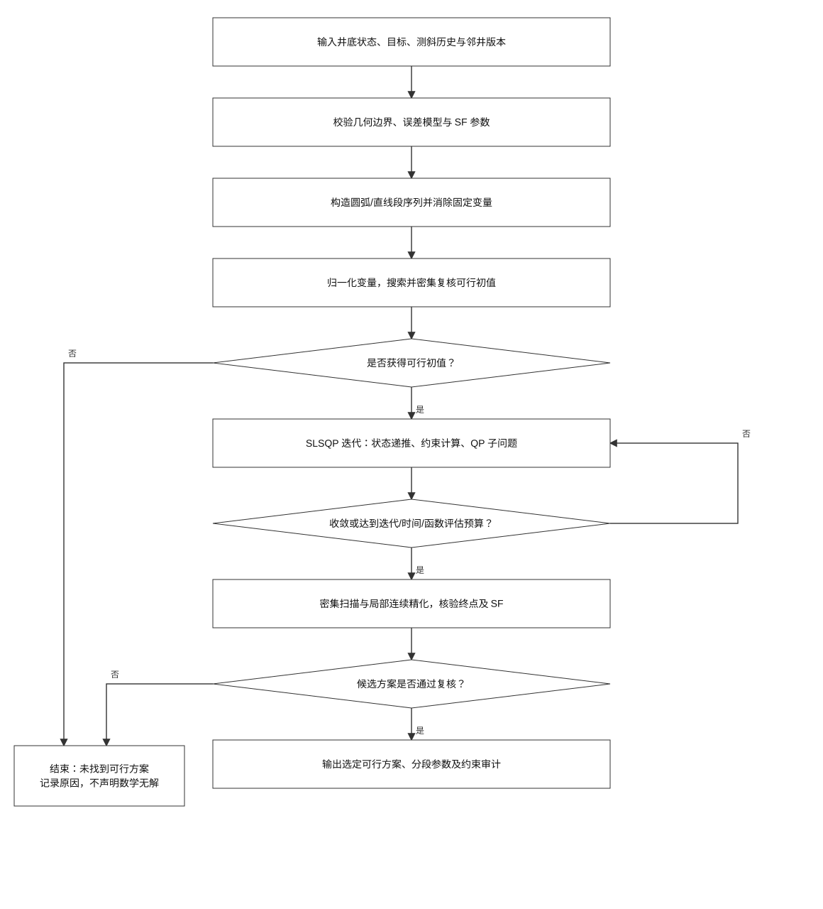

图3-1 防碰约束下的轨道再规划流程（[draw.io源图](docs/diagrams/algorithm-flow.drawio)）

**算法3-1 防碰约束下的待钻轨道再规划**

```text
输入：实钻末点与历史、目标、邻井版本、段序列、工程边界、误差参数
输出：已验证的待钻方案与约束审计，或本次任务失败原因
1. 校验数据归属、测深顺序、坐标基准、控制边界和参数完整性。
2. 将输入变换至统一坐标体系，固定已钻历史及邻井轨迹版本。
3. 构造圆弧/直线段序列，固定直线曲率，消除上下界相同的控制量。
4. 归一化活动变量，并建立长度目标、中靶及分离系数约束。
5. 按固定种子生成初值，最小化违反约束的残差。
6. 对候选初值执行常规及密集检查；若均不通过，记录并结束。
7. 对每个选定初值调用优化器；每次迭代递推整条待钻轨道并更新约束。
8. 达到收敛条件、迭代数、函数评估数或正式优化时间预算时终止迭代。
9. 对迭代候选与保留候选进行密集复核，选择其中较短的可行方案。
10. 根据段几何生成轨道表、工具面和导向建议，输出约束及数值状态。
11. 对已钻历史与新方案进行独立结果扫描，形成可回查的防碰成果。
```

### 3.5 算法实现

#### 3.5.1 输入组织与状态计算

数值实现采用 Python 和 SciPy，并以所提供轨迹计算引擎作为唯一规划数值内核。业务程序负责校验和组织输入，不另行维护一套近似圆弧求解器。算法入口将起始状态、目标、段边界与邻井测斜历史构造成一个完整规划问题。模型中的每个邻井具有唯一身份，避免名称相同的文件覆盖内部缓存。

状态递推从 $\boldsymbol p_0,\boldsymbol t_0$ 开始，逐段执行式（3-6）。由切向恢复井斜、方位后，计算轨迹内部极值、终点误差及工具面变化；随后根据包含实钻历史的测量序列计算协方差，生成分离系数约束。一次迭代中多次请求相同控制量时可复用该次评价，控制量改变后重新计算。

对于圆弧段，程序同时保存起始工具面角、末端几何工具面角和段狗腿度。轨道表由同一连续曲线采样生成，不通过两个端点的线性坐标插值替代。相邻段共享端点，在形成测斜序列时去除重复测深；分段结果表仍保留每一段边界，以兼顾协方差传播所要求的严格递增测深和工程分段审查。

#### 3.5.2 求解控制和结果判定

程序分别记录初始化、求解器运行和最终验证耗时。正式优化可设置迭代数、函数评估数、单次运行时间及特定求解器容差；达到预算后停止搜索，不产生“已经收敛”的假报告。结果判定以最终复核为依据：中靶、姿态、井斜、曲率和分离系数均满足要求时才形成可行方案。

对存在多个初值的任务，按统一长度目标比较通过验证的候选。未配置邻井时，只验证几何与中靶约束，分离系数留空；不能用零或任意大数伪装成完成了邻井防碰。数据版本、误差参数和求解配置随任务一起保留，使历史方案在当前版本改变后仍可解释。

#### 3.5.3 轨道表与导向建议

结果轨道表至少包含测深、北坐标、东坐标、垂深、井斜、方位、段长、狗腿度、工具面角及约束状态。工具面由段的空间几何确定。滑动和复合比例按给定造斜能力估算，采用 $\rho_s=\operatorname{clip}(q/q_{cap},0,1)$、$\rho_c=1-\rho_s$。该比例为导向建议，未考虑地层响应、旋转造斜贡献和工具动态特性，因而不能当成井下执行器的实测比例。

计算量主要由可行性搜索、约束迭代和井间评价决定。设规划与邻井扫描点数分别为 $P,Q_j$，不采用筛选的配对比较上界为 $O(P\sum_jQ_j)$；空间索引和包围范围筛选降低实际候选数量。增加段数不仅增加控制变量，还会改变可行初值搜索难度，因此更多段不必然在相同预算下得到更短方案。

### 3.6 算法对比分析

#### 3.6.1 实验组织与评价指标

实验采用算法项目中保存的三个测试场景 A、B、C，在相同起点、目标、ISCWSA Rev.0 参数、邻井约束和时间预算下比较四种求解方法。系统工程数据的导入、权限和页面核验属于第4章的系统测试，不在本节作为算法性能结果重复列出。

评价指标包括待钻长度、终点误差、最低分离系数、求解时间、最终可行性及所选候选的数值收敛状态。同一布局中的四种方法采用相同初值摘要，以减少初值差异。原实验每种方法只有一次运行，因此结果用于说明实例行为，不据此估计总体成功率或给出统计显著性结论。提供的实验输出已按文件摘要保存在文后材料中；本文未将其他论文的预测误差表当成自身实验结果。

#### 3.6.2 单圆弧基础算例

基础算例的起始位置为 $(0,0,0)$ m，井斜35°、方位20°；目标为 $(54.7641,58.3134,124.8642)$ m，目标井斜36.1482°、方位72.7988°，位置容差0.1 m。该算例没有邻井，主要验证轨道几何与优化器接口，因此最低分离系数为空。

**表3-3 同初值单圆弧算例的求解结果**

|方法|待钻长度/m|优化耗时/s|数值收敛|最终几何可行|
|---|---:|---:|---|---|
|SLSQP|149.898461|0.004459|是|是|
|信赖域约束法|149.924637|0.027622|是|是|
|COBYLA|149.898461|0.036419|是|是|
|COBYQA|149.898461|0.080612|是|是|

四种方法均返回满足要求的轨道。SLSQP、COBYLA和COBYQA的长度接近，信赖域方法在本次终止条件下略长。由于单次耗时处于毫秒量级，并包含运行环境波动，表中差异不能用于承诺线上请求的响应时间。其更主要的作用是验证共同几何模型下各求解方法能够返回一致量级的可行结果。

#### 3.6.3 含邻井约束的段式与求解器比较

采用提供程序中的合成邻井算例，比较一圆弧、三圆弧、五圆弧和圆弧—直线—圆弧四种布局。每个布局中的初值在四种方法间共享，分离系数阈值均为1.5，正式优化预算约为25 s。表3-4记录了可行方案长度及最低分离系数，表3-5进一步区分所选候选是否由收敛的优化器输出。

**表3-4 含邻井算例的方案长度与最低分离系数**

|段式布局|SLSQP：长度/m；SF|信赖域：长度/m；SF|COBYLA：长度/m；SF|COBYQA：长度/m；SF|
|---|---|---|---|---|
|一圆弧|未找到可行初值|未找到可行初值|未找到可行初值|未找到可行初值|
|三圆弧|75.270647；3.023176|75.384973；2.964367|76.853608；2.349525|76.853608；2.349525|
|五圆弧|76.814031；2.297865|75.565055；2.341077|76.814031；2.297865|76.814031；2.297865|
|圆弧—直线—圆弧|74.766079；2.289720|74.766781；2.289782|76.013301；2.312527|76.013301；2.312527|

**表3-5 部分方案的求解状态及候选来源**

|布局与方法|优化耗时/s|所选候选数值收敛|候选来源|
|---|---:|---|---|
|三圆弧，SLSQP|4.681242|是|优化迭代结果|
|三圆弧，信赖域|25.008159|否|通过复核的迭代候选|
|三圆弧，COBYLA|25.003806|否|已验证初值|
|三圆弧，COBYQA|25.008993|否|已验证初值|
|圆弧—直线—圆弧，SLSQP|1.706622|是|优化迭代结果|
|圆弧—直线—圆弧，信赖域|20.235109|是|优化迭代结果|

一圆弧布局未找到可行初值，说明该模型与本次搜索配置不足以获得可行方案，不构成无解证明。在相同邻井条件下，圆弧—直线—圆弧的SLSQP结果较三圆弧缩短约0.505 m；五圆弧在相同预算下未取得更优结果，反映出模型自由度与搜索难度之间的权衡。COBYLA和COBYQA返回的可行设计部分来自初始化阶段，不能因结果可行便宣称优化器已收敛。以上结果支持以SLSQP作为本系统默认方法，同时保留其他方法处理不同初值和约束条件。

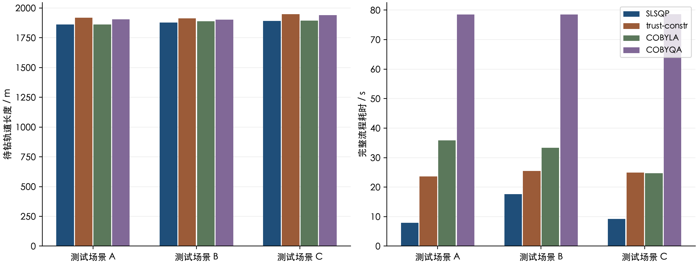

图3-2 同初值求解器比较：长度与正式优化耗时分开表示

#### 3.6.4 三个测试场景下的四方法比较

表3-6报告算法项目保存的场景 A、B、C 对比输出。目标值为待钻轨道总长度，时间为从共同预处理结束到方案复核完成的完整流程时间；数据来自各场景的 `algorithm_comparison.csv`。一次运行结果用于说明算法在给定输入和预算下的行为，不据此推断统计显著性或全局最优性。

**表3-6 场景 A、B、C 中四种方法的时间与目标值**

|场景|SLSQP：时间/s；目标值/m|trust-constr：时间/s；目标值/m|COBYLA：时间/s；目标值/m|COBYQA：时间/s；目标值/m|
|---|---|---|---|---|
|测试场景 A|7.871；1861.555|23.583；1919.038|35.843；1862.962|78.547；1903.736|
|测试场景 B|17.665；1879.267|25.443；1914.234|33.314；1888.013|78.540；1903.431|
|测试场景 C|9.214；1892.328|24.899；1947.411|24.684；1892.980|78.596；1939.632|

三种场景中，SLSQP均在较短时间内返回可行方案；trust-constr和COBYLA的部分结果由通过复核的候选保留，数值状态应结合原始报告解释；COBYQA在给定预算下耗时较长。目标值是约束满足后的长度，不能脱离场景、约束和时间预算进行横向排名。系统默认 SLSQP，同时保留其余三种方法供工程人员复核。

### 3.7 算法可视化分析

#### 3.7.1 优化过程分析

图3-3采用原实验中记录的SLSQP迭代历史，同时绘制长度和最大归一化约束违反量。早期迭代点可以短于最终方案，却违反目标或其他约束；因此不能仅凭长度下降判定改进。随着约束违反量趋近容差，方案长度稳定到可行边界附近。对预算耗尽的运行，应结合候选来源判断曲线末点是否就是最终采用的方案。

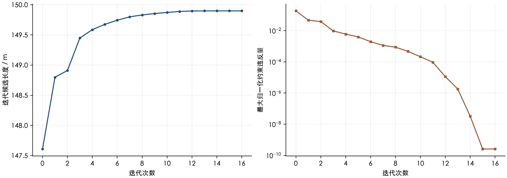

图3-3 单圆弧基础算例的迭代过程

#### 3.7.2 二维与三维轨道分析

三维图反映再规划轨道、实钻历史和邻井的整体空间关系；水平投影用于辨识方位变化及平面接近区间；垂直剖面用于检查垂深和剖面位移。剖面位移按 $V=(N-N_0)\cos A_v+(E-E_0)\sin A_v$ 计算，必须注明剖面方位角 $A_v$。水平投影接近并不等于三维接近，三维中心距大也不等于分离系数充分，两者需要结合解释。

图3-4给出一个待钻轨道方案的三维、水平和垂直剖面示例，圆点表示轨道采样和段边界。三种视图使用同一组算法输出，不对不同视图分别拟合曲线；图中位置采用相对坐标以便阅读。该图用于说明可视化分析方法，不作为系统工程案例验收结果。

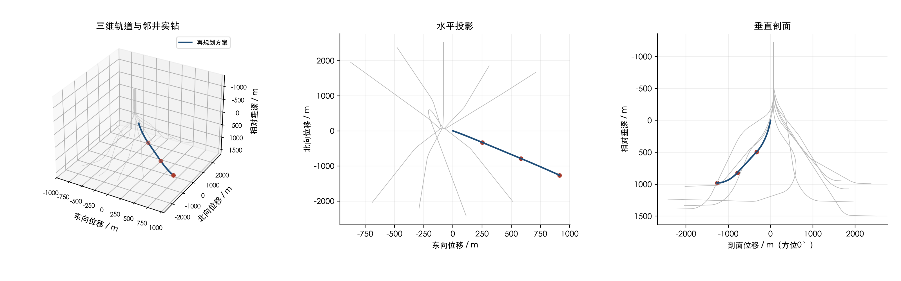

图3-4 再规划方案的三维、水平和垂直投影

图3-5进一步说明自动邻井筛选中测点包络与连续轨迹包络的差异。仅对离散测点取极值会漏掉弯曲井段的内部凸出部分；在完整圆弧上求极值后再建立闭包盒，可以避免这一类遗漏。完整闭包盒仍会包含较大的空白区域，因此后续详细扫描不可省略。

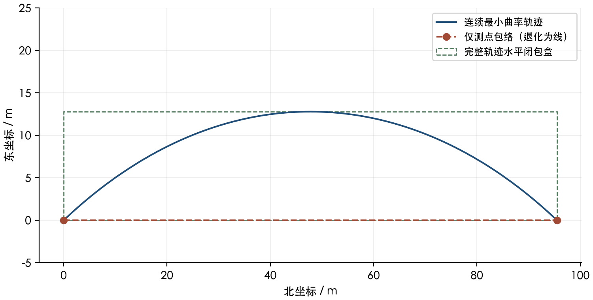

图3-5 闭包盒应覆盖测点之间的圆弧极值

### 3.8 本章小结

本章从实钻偏离后的待钻轨道调整问题出发，建立了包含最小曲率状态递推、中靶、段长、曲率和分离系数约束的长度最小化模型，说明了活动变量消元、归一化、可行初值恢复、SLSQP优化和密集复核的完整过程。实例表明，合理段式能够在给定预算下提高获得较短可行方案的机会，而可行设计、数值收敛和全局最优是不同层次的结论。下一章在该计算过程基础上，讨论工程数据、版本、权限及交互工作区的系统实现。

## 第4章 实时钻井系统设计与实现

### 4.1 引言

轨道优化计算需要明确的工程归属、可追溯的测斜版本和可靠的参数输入。若来源文件、实钻复测和设计修订混杂存放，即使求解器返回数值结果，也难以回答结果采用了哪条井眼、哪次测量以及哪组误差参数。因此，本系统将工程组织与文件数据管理统一到区块—井场—井—井眼层级，以井眼为实时展示和工程任务的基本对象，并以不可变版本衔接数据接入、评价和再规划。

参考相关系统研究中对总体架构、逻辑交互、数据结构及测试的论述方法[2-3]，本章先分析系统需求和设计目标，再说明总体架构、业务过程和数据库设计，最后给出功能实现、单元及集成测试，以及实际运行页面。系统界面沿用若依的表单、表格、查询和权限管理方式，工程工作区借鉴DrillPlan的面板组织[5]，不包含独立轨迹设计、套管磨损或商业软件精度验收模块。

### 4.2 需求分析与系统总体设计

#### 4.2.1 功能需求与角色

系统服务于系统管理员、工程师和游客三类用户。系统管理员维护账号、角色、菜单、组织与功能授权；工程师在授权工程范围内维护资料、确认版本及参数并执行评价和再规划；游客使用有期限的账号访问授权演示内容，不实际修改工程数据或启动正式计算。系统不开放注册，初始密码登录后必须完成修改，账号标识由系统生成且不可更改，账号名称允许用户按唯一性规则维护。

核心业务以工程目录为入口。在区块下管理井场，在井场下管理井，在井下管理主井眼和分支井眼；选定井眼后查看来源原件、设计轨道、实钻测斜、复测修订及相关任务。已有井眼可被其他井场引用为邻井，其原件和数据版本继续共用，不因参加另一个评价而重复导入。

实时大屏用于展示接入数据，左侧为井眼状态与实测参数，中部为三维轨迹，右侧上下分别为垂直剖面和水平投影。数据源配置、连接诊断及事件提交属于实时接入功能。防碰评价、姿态预测和轨迹再规划分别设置独立入口；模型仓库与增量学习参数属于姿态预测内部，不单独设置顶层训练平台。

#### 4.2.2 非功能需求

工程可信性要求每次计算能够定位实钻、设计与邻井的具体版本，并保存实际采用的参数；参数未确认时应阻止正式评价。交互性能要求不同页面共用已读取的工程上下文和实时快照，避免切换页面时重复加载大体量轨迹或并发启动全井扫描。维护性要求数值计算与权限、文件、任务记录解耦，能够分别验证和部署。可扩展性主要体现在输入解析器、预测模型适配器和报告模板扩展，而不是在页面上堆叠未实际接入的选项。

#### 4.2.3 总体架构

系统采用浏览器、业务服务、计算服务和持久化存储协同的架构，如图4-1所示。浏览器负责工程交互和轨迹显示；Java业务服务统一处理身份认证、工程范围权限、文件版本及任务审计；Python计算服务执行提供的轨迹数值内核、文档解析、预测适配及报告生成；MySQL保存结构化业务数据，文件目录保存来源原件、模型和生成文件。

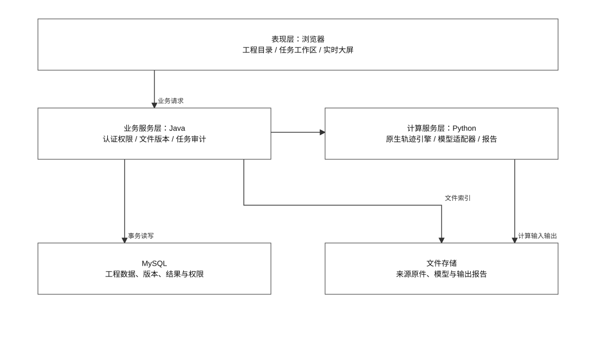

图4-1 系统总体架构（[draw.io源图](docs/diagrams/system-architecture.drawio)）

将Java业务服务置于浏览器与计算服务之间，可以在计算前完成授权和版本绑定。浏览器提交的井号、坐标和误差值并非天然可信，业务服务须根据已授权版本重新构造数值输入。计算服务返回的结果随后由业务服务保存，形成输入、执行和输出之间的对应关系。图4-2给出实际采用的技术体系。

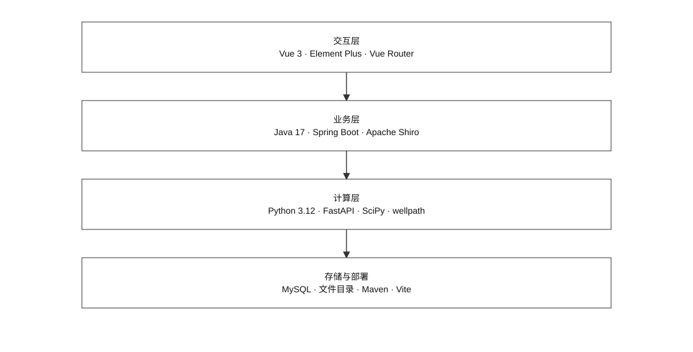

图4-2 系统技术体系（[draw.io源图](docs/diagrams/technology-stack.drawio)）

前端采用Vue 3与Element Plus，使用路由划分功能页面。业务服务基于Spring Boot与Apache Shiro，Java模块由Maven统一管理依赖和构建。计算服务基于FastAPI、NumPy和SciPy；原生轨迹程序以固定版本包接入。二维及三维轨迹采用原算法的Plotly图形体系，在网格、图例、坐标和剖面方位方面保持一致；实钻与邻井实钻只画轨迹线，设计和再规划只在关键节点或分段端点画圆点。数据库使用MySQL，开发和本地运行可通过统一脚本启动Java、Python与前端服务。

#### 4.2.4 功能模块划分

图4-3将系统划分为工程与资料管理、实时监测、工程任务、系统与运行维护四部分。模块划分以用户完成的业务为依据；同一份测斜版本可被不同任务引用，但只在工程目录中维护其来源与发布状态。报告在相关成果处导出，避免再建立一套与工程目录重复的文件管理界面。

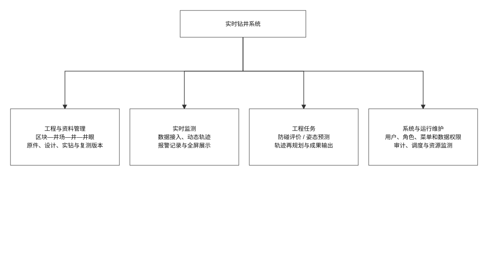

图4-3 系统主要模块（[draw.io源图](docs/diagrams/system-modules.drawio)）

### 4.3 系统逻辑设计

#### 4.3.1 工程业务流程

图4-4以工程师的操作顺序描述“实时展示—姿态预测—防碰评价—轨迹再规划”的闭环。预测和评价不是再规划页面中的装饰性结果，而是再规划的前置判断和复核环节：实时接入形成当前实钻版本后，姿态预测使用已启用模型计算钻头前方的姿态和位置；防碰评价同时对实钻轨迹和预测位置进行井间距法、分离系数法评价；若预测区间或实钻区间达到风险条件，系统才将风险井段、最低SF、关联邻井版本和预测MD带入再规划输入。再规划仍以最新实钻测点末点作为几何起点，预测结果只用于确定待钻风险范围、目标调整建议和约束审查，不能替代实测起点。

再规划求解完成后，系统把候选方案作为临时轨道重新执行防碰评价，并将评价结果回写到方案约束审计。只有方案通过分离系数约束、工程段长/曲率约束和目标点约束，才允许保存为可供工程人员确认的方案；否则返回风险井段和违反的约束，工程人员调整输入后再次求解。没有可用预测模型时，系统继续评价实钻轨迹，但明确预测状态为空，不用几何外推冒充模型预测。该图描述业务操作，不以模块之间的数据传输代替业务流程。

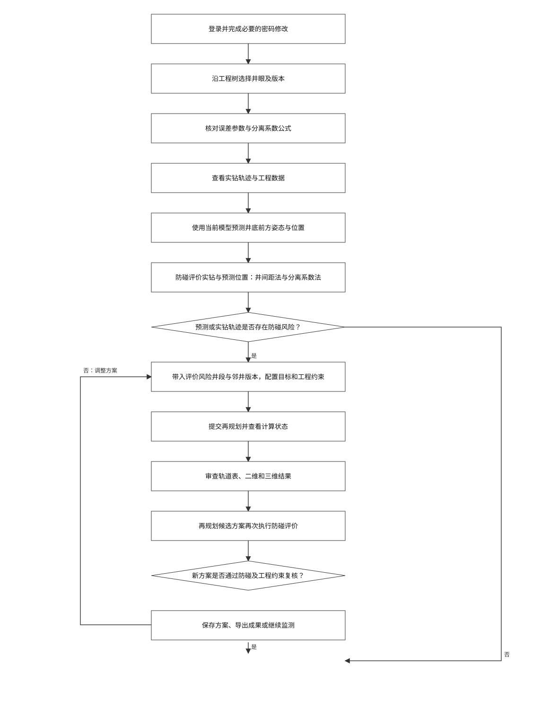

图4-4 工程师业务流程（[draw.io源图](docs/diagrams/business-flow.drawio)）

实时监测发现达到报警等级的未来风险时，系统提供弹窗和声音提醒，并可携带当前井眼、实钻版本、预测结果、风险MD范围及相关邻井版本进入再规划。该操作建立待处理任务上下文，不应自动将未经核对的目标点或预测角度当作正式施工方案。未登记可用预测模型时，页面明确显示未生成模型预测；此时不能产生“预测参与再规划”的假结果。

业务闭环可按以下顺序复核：

1. **预测参与判断**：从实钻版本末点开始，模型返回未来姿态点及模型版本；服务端保存预测输入、输出和模型标识。
2. **评价参与判断**：评价任务读取同一实钻版本、预测点和已确认邻井版本，返回最近井对、风险MD带、中心距曲线和SF曲线。评价结果中的风险邻井集合成为再规划的默认邻井集合。
3. **再规划参与计算**：再规划读取实钻末点作为起点，读取评价产生的风险MD带作为约束审查范围，读取预测终点/姿态作为可选目标建议；工程师可以修改目标和段约束，不能修改历史实测点。
4. **闭环复核**：求解候选方案后重新执行防碰评价，比较原始方案、再规划方案和邻井关系；只有复核通过的方案进入方案历史，失败方案保留失败原因和约束审计。

#### 4.3.2 来源解析与版本发布流程

来源文件先登记摘要和原始文件索引，再解析工程归属、资料用途、坐标基准、测斜表位置及候选邻井。新导入井或井眼的数据必须经过表单核对，工程人员可以修改自动解析结果；确认通过后才允许生成可使用轨迹版本。已有已确认资料不因切换页面重复要求确认。

完整导入创建初始版本；增量导入从已有版本续接后续测点；复测修订替换指定测深区间，并形成新的不可变版本。原版本始终保留，当前版本指针只说明默认采用哪个版本。设计轨道与实钻测斜分别发布，设计修订不能覆盖实钻当前版本。业务修订号与内部顺序版本同时保存，用于区分原件中类似rev#7的编号和数据库版本序号。流程如图4-5所示。

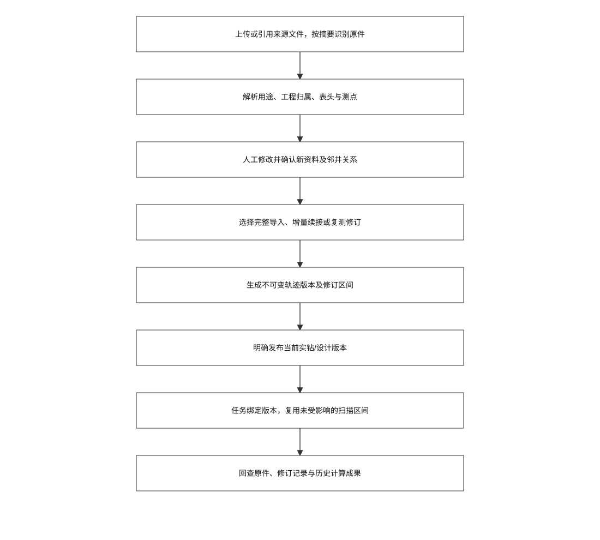

图4-5 来源解析、人工确认与版本发布（[draw.io源图](docs/diagrams/source-version-flow.drawio)）

#### 4.3.3 评价配置的强制确认

不确定性参数决定误差范围，分离系数公式决定评价口径，二者应在开始使用工程评价功能前明确确认。系统在当前会话首次进入工程页面、切换井场、修改误差配置或服务重新启动后，核验该用户是否确认当前参数。弹窗首先展示不确定性放大系数K，再展示轨道不确定性模型、分离系数公式及与之有关的参数；不混入求解器、段数和无关显示选项。

弹窗不能通过关闭按钮、Esc键或点击遮罩关闭。跳转至参数设置允许修改参数，离开设置页后仍须确认。网络错误保留阻断状态，重试成功或完成确认后才解除。后台同时校验用户、会话和误差配置摘要，未确认的正式评价与再规划请求返回前置条件错误，避免仅靠前端弹窗形成可绕过的控制。求解器等无关配置变化不改变误差配置摘要。

#### 4.3.4 任务交互时序

图4-6描述一次工程计算的时序。浏览器传入任务选择，业务服务验证授权和参数确认记录后，从数据库取出对应版本；计算服务仅接收规范化后的测点和配置。计算完成后，业务服务保存任务及结果，并向浏览器返回工程成果。请求与返回分处不同高度，箭头线路互不重合。

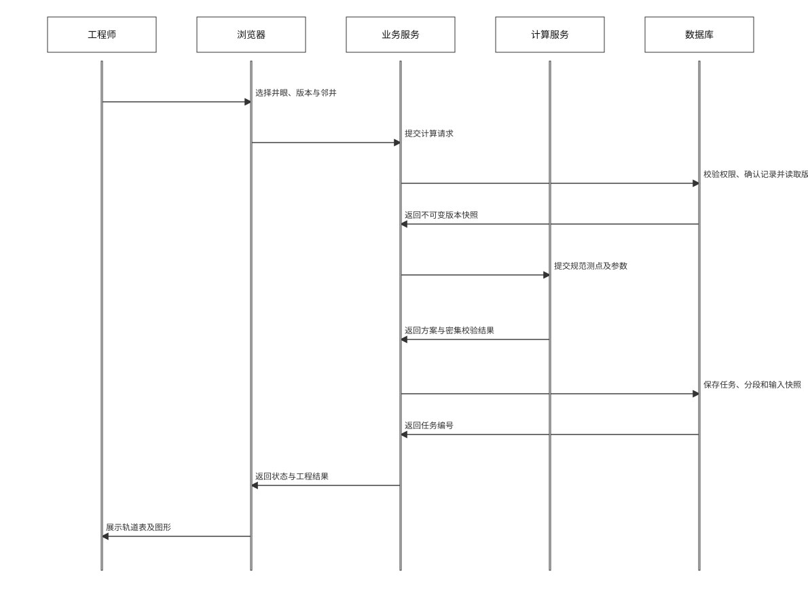

图4-6 工程任务交互时序（[draw.io源图](docs/diagrams/sequence-realtime-collision.drawio)）

#### 4.3.5 防碰增量更新逻辑

实钻末点新增时，系统从新版本的修订记录确定受影响测深起点，并将前一相邻圆弧段纳入重算。复测修改历史测点时，应进一步考虑其对后续坐标和协方差传播的影响，不能只更新被替换的几个测点。邻井版本、误差模型、扫描步长或阈值改变时，相应依赖的缓存也应失效。

缓存复用以输入版本和参数摘要为依据，保存已完成扫描块；更新后只重算受影响且依赖不同的范围。返回结果同时报告复用块数、重算块数及实际评价范围。完整重复请求若输入与依赖未变化，可直接复用已完成区间；缓存命中并不等于跳过版本和权限检查。

### 4.4 系统数据结构设计

#### 4.4.1 工程对象与资料对象

系统工程层级为区块—井场—井—井眼，不存在井工程的项目层级。区块表达地质或开发区域，井场表达实际作业组织范围，井表达地面井口工程实体，井眼表达井内可独立计算和施工的空间通道。井眼下附着设计轨道、实钻测斜及其他工程资料，这些是资料类别而非新的行政层级。

对于煤岩气井资料，区块按文档中的构造位置组织为“鄂尔多斯盆地伊陕斜坡”，再按实际井场和井号分配11口井。对于Volve资料，将来源site“Volve F”用于井场归属，井按官方井号识别，主井眼及侧钻分支分别管理。来源文档中的Project或文件目录名称可以作为来源元数据保留，但不据此创建工程管理层级。测试案例统一置于测试区块及测试井场，其数据仍经过同一管理流程。

工程对象通过稳定标识关联，不通过展示名称拼接确定身份。井号别名用于匹配文件中的历史称谓，同一井眼的不同版本不能因文件名差异生成重复井眼。工程树支持逐层定位，并在需要多选的邻井和可视化场景允许勾选上级节点，联动选择其下全部有效井眼。单次任务的正钻对象仍为一个井眼，以避免多口井同时成为不明确的规划起点。

#### 4.4.2 文件、测点与修订的分离存储

原始文件保存上传字节和摘要，结构化测点保存参与计算的规范数值。解析记录说明测点来自哪个工作表、文本段或页表；轨迹版本说明这些测点属于哪个井眼、实钻还是设计及其坐标基准；业务修订说明工程成果的名称、用途和修订号。这样既能原样下载文件，也能查询数值并追溯其来源。

文件不因被多个任务使用而复制，测点不因当前版本切换而覆盖。一个业务修订可以包含多个文件，例如同一设计的PDF报告、TXT数据及表格附件；同一原件也可以包含多个可解析表。系统以修订、文件和数据版本之间的关联表达这些关系，避免“一个文件必然等于一个版本”的错误假设。

#### 4.4.3 任务快照与结果对象

任务输入快照包括参考井眼及测斜版本、邻井版本集合、目标、段边界、误差参数和求解选项。结果由任务摘要、分段控制表、轨道采样和约束审计构成。数据库使用结构化字段索引常用查询条件，JSON保存异构数值配置与完整结果；不能只保存一段浏览器无法解释的自由文本。

表4-1列出主要数据对象及其生命周期。

**表4-1 主要数据对象及生命周期**

|对象|创建或变化时机|保留规则|主要引用者|
|---|---|---|---|
|工程对象|新增区块、井场、井或井眼|标识稳定，状态可调整|目录、权限和全部任务|
|来源原件|上传或引用文件|保留原字节与摘要|解析记录、业务修订|
|轨迹版本|完整导入、续接、复测|测点不可变，当前指针可变|评价、预测、再规划|
|邻井关系|候选筛选及人工保存|按参考井眼记录包含、排除和版本策略|防碰及规划输入|
|配置确认|核对本会话当前误差参数|绑定用户、会话和参数摘要|正式计算前置校验|
|任务快照|提交计算|历史记录不随当前配置变化|历史回查、报告导出|
|模型版本|导入模型或增量学习完成|基础模型和新版本分别保留|预测任务及自动更新|

### 4.5 数据库设计

#### 4.5.1 数据库组织原则

数据库采用关系模型保存工程组织、授权与版本索引，使用事务保证当前版本发布和业务关联的一致性。对具有独立身份和查询需求的对象分别建表；对误差参数、外部文档属性和完整算法结果等结构不固定的信息采用JSON列。文件正文不写入多张业务表，数据库仅保存索引和摘要，减少存储重复。

本次以运行库结构为准，共核对86张表、844个字段和72项物理外键约束。表的分类见表4-2。所有表均在附录A给出完整字段设计，避免只列几个核心表而遗漏权限、运行维护和版本支撑结构。数据库关系总图见图4-7，分类外键关系图见附录B。图中将业务关联与物理外键分开说明，不能将程序中使用的编号字段全部声称为已建立数据库外键。

**表4-2 数据表分类**

|类别|数量|主要内容|
|---|---:|---|
|工程层级与业务资料|14|区块、井场、井、井眼、工程目录与业务修订|
|来源文件与轨迹版本|12|来源原件、解析、确认、测斜点与实钻复测版本|
|防碰与再规划|10|邻井关系、评价任务、规划方案、约束及参数确认|
|实时接入与业务运行|9|连接器、幂等事件、报警、执行及成果索引|
|模型与增量学习|7|模型、预测任务、训练数据与自动增量更新|
|账号角色与组织授权|17|账号、角色、菜单、组织和井场数据授权|
|系统运行与审计|17|字典、公告、调度、日志、迁移和开发支撑|
|合计|86|当前运行库全部物理表|

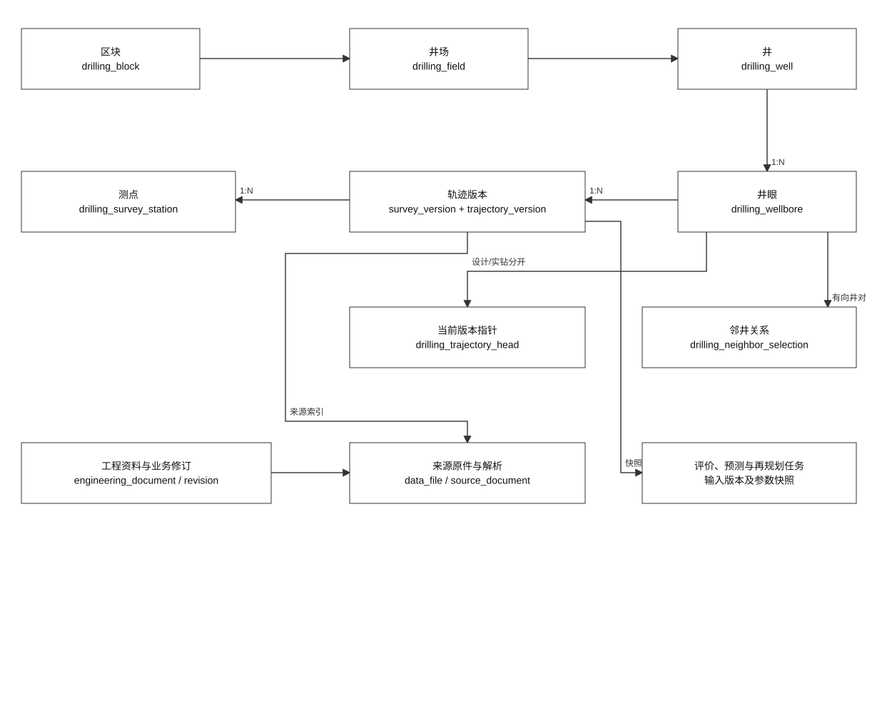

图4-7 数据库主要结构关系（[draw.io源图](docs/diagrams/database-relationship.drawio)）

#### 4.5.2 工程层级与共享邻井

区块表通过区块标识与井场表建立一对多关系；井场通过井的归属关系管理井，井通过井标识管理多个井眼。井眼引用表允许一个已存在井眼进入其他井场的邻井范围，区别于改变该井原有归属。工程目录节点和业务资料节点用于统一显示层级、资料分类及修订，属于业务索引，不重新复制物理井眼。

井号别名表将来源中的不同名称映射到同一井。井目录关联维护实际归属，工程文件关联和修订数据关联分别连接来源文件及数值版本。当前业务修订指针和当前轨迹版本指针各司其职：前者说明成果修订，后者说明计算默认使用的数据。

#### 4.5.3 实钻、设计与复测版本

测斜版本主表保存内部版本号、父版本、来源文件、导入方式、末点测深和配置快照。轨迹版本扩展表进一步保存井眼、轨迹用途、内容摘要和坐标参考；测点表以版本及测深组织查询。当前轨迹指针按“井眼＋轨迹用途”区分实钻和设计，使两者独立发布。

复测修订表记录修订类型、受影响测深范围及修订摘要。增量导入和复测均产生新版本，父版本用于追溯，已发布历史不原地修改。当前指针切换采用预期旧版本检查，以免两名工程师同时操作时静默覆盖对方发布。版本选择器显示用途和版本，任务保存具体版本身份，而不只保存一个“当前”字符串。

#### 4.5.4 任务、权限与辅助表

防碰任务、参与井集合和结果分别保存任务级参数、井对输入和风险成果。再规划主表保存起始测斜版本、目标、求解方法、约束和完整结果，分段表保存可独立审查的段参数。主表中的历史兼容列不作为新增业务功能入口；例如规划场景列不再决定模型，段序列由明确的轨道模型配置决定。

用户、角色、菜单、部门和岗位使用若依既有关系模型；工程账号策略、角色模块授权和井场成员进一步限制业务操作范围。系统字典、调度、公告及日志属于通用支撑结构。测斜问题隔离表保留解析异常记录，不对应一个独立质量管理模块。开发生成表保存后台开发元数据，不属于井工程层级。迁移表记录结构演进，也不作为用户管理对象。

### 4.6 系统功能模块设计与实现

#### 4.6.1 工程目录与资料管理

工程管理采用左侧工程树、右侧对象信息和资料列表。选择不同类型节点时展示相应维护动作：区块维护井场，井场维护井，井维护井眼，井眼维护设计与实钻资料。文件和数据在同一入口下通过页签组织，避免工程归属、文件上传和版本管理各自建立不一致的目录。

解析器支持表格、CSV、TXT及所提供的无后缀文本资料，保留原文件类型、来源路径和解析定位。重复文件按摘要识别，批量导入逐文件记录状态；重复点、非递增测深和非法角度在导入阶段识别，不静默覆盖已发布数据。新资料弹窗允许修改解析结果，人工确认后用于计算。已有确认数据直接可用，不在常规页面增加重复的确认说明文字。

#### 4.6.2 防碰评价

评价工作区左侧选择正钻井眼、实钻版本和参与邻井，并设置扫描步长。邻井按完整工程层级展示，可勾选井、井场或区块批量选择其下有效井眼。已有实钻邻井不再并列要求选择设计轨道，历史版本通过明确策略固定。

结果区以三维轨迹为默认视图，通过页签切换二维投影和防碰详情。防碰详情按井对列出最小中心距、最低SF、对应测深及风险井段；右侧上下显示两种二维投影。图形和表格共享任务结果，切换仅改变展示，不重复提交扫描。井间距法和分离系数法始终同时返回。结果可以导出表格、报告及图形，原始版本仍可从资料入口下载。

#### 4.6.3 姿态预测与模型管理

预测页面选择一个井眼的实钻版本、模型和预测步长，显示当前姿态及未来测深位置。模型仓库登记基础模型、推理适配器及新模型版本；自动增量学习基于新到测点在原模型上继续训练，可配置样本门槛、时间间隔、窗口、学习率、轮数和批次等参数。训练执行记录、日志和模型版本保留，用于追溯一次预测的来源。

当前未提供可用于业务推理的已训练模型时，系统返回明确未配置状态，未来井斜和方位保持空值。零长外推、9 m、28 m、工具面及模型指标可以作为结果栏位保留，但不得填入随机样例角度。几何外推只作为单独标识的工程辅助，不伪装成模型预测。

#### 4.6.4 轨迹再规划工作区

再规划页面由对象标题、操作工具栏、输入栏、结果主区、上下文栏和底部审查区构成，如图4-8所示。输入栏将井眼与版本、目标、约束和求解设置分成可折叠部分；“结果方案”页签展示求解后的段长、狗腿度、工具面和约束状态。全局与分段约束只能选择一种。

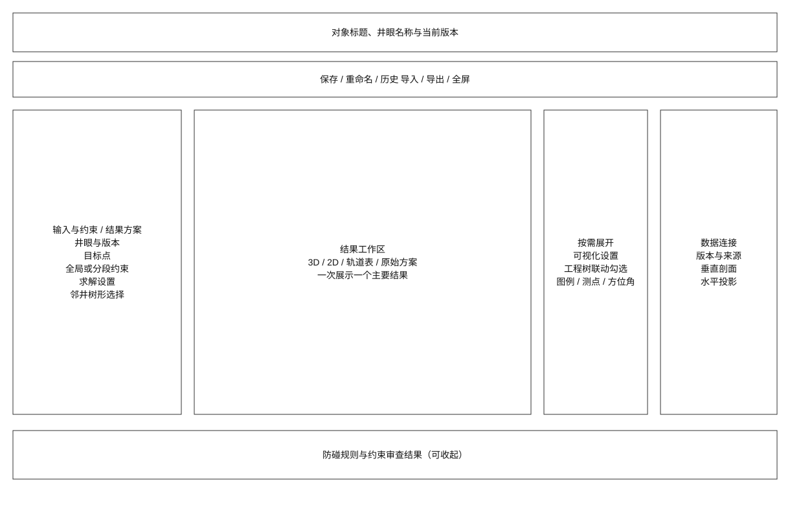

图4-8 工作区布局（[draw.io源图](docs/diagrams/page-layout.drawio)）

中间区域通过3D、2D、轨道表和原始方案页签切换主要成果，不将所有结果同时堆放。正钻井的实钻历史、原始设计、再规划方案与邻井实钻轨迹使用不同图例；轨道表和图形来自同一份结果。右侧保留版本来源、邻井连接和二维轨迹。可视化设置通常隐藏，点击图标后在主区和右栏之间展开，形成第四栏；按工程树管理轨迹显示，支持上级整组勾选及全部显示、隐藏。

#### 4.6.5 实时大屏与接入

实时大屏以一个正在钻进井眼为中心，展示实测参数、三维轨迹、两种二维投影和风险状态。井眼切换采用工程树。全屏按钮使用浏览器屏幕全屏接口，使大屏脱离浏览器内容区域；退出后恢复原页面。图形容器变化时调整尺寸，避免放大后保留原来的窄图。

实时接入单独维护WITS TCP、串口、WITSML、文件和SQL数据源。事件以来源和幂等标识去重，乱序或非法数据保留诊断信息；有效测点生成新版本并提示受影响井段。共享实时快照和请求序号防止旧井眼请求晚返回后覆盖新井眼显示。自动刷新仅在允许的页面和可用会话下运行，避免后台页面持续触发重复扫描。

#### 4.6.6 输出成果与原件保真

文件下载区分来源原件和由当前版本重新生成的成果。原件下载读取登记的原字节，利用摘要验证内容一致；修改测点后导出则依据对应模板回填，生成与当前版本关联的新文件，不能继续使用原件摘要声称完全未变。标准测斜报告、井总结、TXT和表格成果按其资料用途归类。

轨道归算表按照SY/T 5435—2012组织测深、井斜、方位、垂深、北东坐标、水平位移、平移方位及曲率等信息；设计轨道和实钻测斜分别采用对应表型[4]。带封皮和图形工作表的来源文件保留工作表结构，数值表与图形共享所选版本。标准附表与工程设计资料可以在资料页查看和导出，计算结果不再建立一套重复文件目录。原件保真与新生成报告的模板一致性分别验证，不将二者混为同一测试。

#### 4.6.7 系统管理与运行维护

用户、角色、部门、岗位、菜单与数据权限沿用若依的列表、查询和编辑交互，功能较多时采用下级菜单归类。账号名称、不可修改的账号标识和显示姓名分别保存，账号授权同时受到菜单权限、角色策略与井场数据范围限制。游客演示不能只在浏览器禁用按钮，写入及计算接口同样校验。

运行维护提供在线会话、访问与操作日志、公告、调度、任务执行及资源监测；CPU、内存和GPU分别展示可获取状态。没有GPU或采集工具不可用时报告对应状态，不伪造利用率。审计记录用于说明谁在何时发布版本、修改参数或提交计算，历史结果仍以任务快照为依据。

### 4.7 系统测试

#### 4.7.1 测试环境与方法

测试在本机运行的Vue前端、Java业务服务、Python计算服务和MySQL数据库上开展。Java使用Maven构建，前端进行生产构建，Python执行完整自动化测试及语法编译检查。浏览器测试在桌面视口及390像素移动视口运行，除检查页面文本外，还检查真实Plotly轨迹数量、树选择联动、参数确认和页面溢出。

测试分为计算单元测试、服务接口集成测试和浏览器交互测试。构建通过只说明依赖解析和编译完成，不替代Java单元测试；当前Java工程没有形成独立JUnit用例集，因此Java行为通过实际HTTP集成测试给出证据。算法实验中的方案可行性与系统功能测试分别记录，系统测试不以商业软件精度对标为前提。

#### 4.7.2 单元测试

表4-3列出本次实现相关的测试对象及判据。防碰模型测试关注公式、误差参数和轨迹几何的实际作用；版本测试关注续接和复测后旧版本不被覆盖；来源导出测试区分原字节往返与模板更新。连续闭包盒测试构造测点东坐标相同而中间圆弧凸出的案例，并通过随机姿态圆弧的密集插值检查闭包是否完整覆盖。

**表4-3 计算及数据处理单元测试**

|对象|测试内容|预期行为|
|---|---|---|
|最小曲率计算|直线、圆弧、段内插值及严格递增测深|几何一致，非法输入拒绝|
|水平闭包盒|圆弧内部极值、竖直段、完整历史和随机圆弧|所有密集采样点均在闭包内|
|不确定性与SF|模型切换、参数变化和各公式|使用实际模型参数，结果随有效参数变化|
|再规划|三类模型、1至5段、全局与分段约束|直线变量消元，约束互斥且逐段完整|
|增量评价|新增、历史修订、依赖改变与重复请求|仅复用依赖一致区间|
|复测版本|父版本、替换范围和当前指针|新建版本，原历史保持不变|
|文件解析与导出|表格、文本、设计资料及原件摘要|来源可追溯，往返数据保持一致|
|预测模型接口|未配置、适配器异常和模型返回字段|不生成伪预测，保留明确失败状态|

完整Python测试结果及执行输出保存在核验材料中。测试覆盖的是给定输入与边界，不代表穷尽所有地层条件或所有文件模板。

#### 4.7.3 服务接口与浏览器集成测试

接口测试使用正常登录会话调用工程目录、版本、邻井及计算接口。测试A、B、C各验证10个井眼、20个当前实钻/设计版本及9个邻井，核对起点确为实钻末点，来源导出与原文件摘要一致，任务历史保存10份输入版本引用。相同条件下再次提交防碰扫描，三个案例均出现已有扫描块复用，测试A复用117块且重算0块。

本次新增交互测试首先清除临时测试用户的确认记录，直接提交正式评价应返回前置条件错误；随后打开弹窗，尝试Esc、遮罩点击、刷新与页面切换，均不得解除未确认状态。完成确认后正常查看和计算；模拟确认接口异常时应保留阻断提示。邻井与视图树分别检查选择上级、清空和部分选择，确认最终输入只含叶子井眼，且同一邻井没有设计与实钻的重复轨迹。

**表4-4 主要集成测试用例与判据**

|编号|操作|判据|
|---|---|---|
|I-01|选择测试井场及正钻井眼|显示完整工程路径，默认井1|
|I-02|勾选邻井的井场父节点，再清空|9个可用邻井联动选择，清空后为0|
|I-03|隐藏、显示某井及整个井场轨迹|图形和树状态同步，正钻对比轨迹仍可分别控制|
|I-04|邻井存在实钻和设计版本|默认及可视化仅加载一个实钻依据|
|I-05|未确认直接提交正式计算|服务拒绝，前端强制提示|
|I-06|未确认时Esc、遮罩和页面切换|保持阻断，不能绕过|
|I-07|确认读取失败、重试及配置变化|失败不放行，有效参数变化需重新确认|
|I-08|重复扫描相同版本，再修订输入|未变区间复用，受影响依赖重算|
|I-09|模型未登记时提交预测|明确未配置，未来姿态为空|
|I-10|桌面、移动及全屏切换|主要控件可访问，无横向整页溢出|

具体执行状态以[本次交互核验记录](docs/verification/current-requirements-browser.json)和[完整测试记录](docs/verification/current-validation.json)为准。测试表中的判据不能代替执行结果；尚未执行的项不计为通过。

### 4.8 页面可视化与实现效果

页面截图取自实际运行系统，使用测试工程数据并遮盖个人头像。图4-9展示工程参数确认弹窗，图4-10展示防碰工作区及层级邻井选择，图4-11展示再规划工作区及按需展开的可视化设置，图4-12展示实时大屏，图4-13展示预测工作区，图4-14展示工程目录与资料管理。图中空结果区表示尚未执行该类任务，不能用预绘图替代实际系统结果。


图4-9 评价参数确认：K、模型、公式及实际参数


图4-10 防碰评价工作区


图4-11 再规划的输入、主要结果、可视化设置和数据连接


图4-12 以井眼为中心的实时数据与轨迹展示


图4-13 模型未配置时的预测页面


图4-14 工程层级和资料版本管理

### 4.9 本章小结

本章完成了以井眼为中心的实时钻井系统设计，将工程组织、来源原件、实钻复测和设计修订放在同一可追溯结构中，并通过参数确认、权限校验和任务快照约束计算入口。系统以独立工作区提供评价、预测和再规划，利用实时展示和增量评价支持钻进过程中的状态观察。数据库覆盖通用管理与钻井业务全部数据表，测试分别验证数值处理、接口约束和页面行为；模型预测性能及复杂现场施工条件下的适用性仍需在接入真实模型和现场数据后进一步评价。

## 参考文献

[1] 王潘涛. 井眼轨迹预测与待钻轨道优化设计方法研究[D]. 中国石油大学（北京）. 重点参考第4章、第5章；本文未将其遗传算法结果作为自身实验数据。

[2] 王兴宇. 基于多模态检索增强生成的中国古代文化常识问答系统设计与实现[D]. 北京邮电大学. 重点参考第6章需求、总体设计、数据表与测试的论述组织。

[3] 韩童彤. 基于时序数据特征案例的卫星故障诊断系统设计与实现[D]. 西安工业大学. 重点参考第5章总体架构、逻辑设计、数据结构、时序和系统测试的论述组织。

[4] 国家能源局. 定向井轨道设计与轨迹计算：SY/T 5435—2012[S]. 2012.

[5] SLB. DrillPlan features[EB/OL]. https://www.slb.com/products-and-services/delivering-digital-at-scale/software/delfi/delfi-solutions/drillplan/drillplan-features. 页面组织参考，非数值精度或专有格式对标依据。

[6] well_control_iscwsa. 所提供轨道优化程序及实验结果[CP]. 本文采用固定版本数值引擎；实验输入、结果与摘要见[算法实验材料](docs/verification/algorithm/manifest.json)。

[7] 提供算法项目运行记录. 测试场景A、B、C的四方法比较输出[DS]. 2026-11-16. 见[算法核验材料](docs/verification/algorithm/)。

## 附录A 数据库全量表设计

本附录按实际业务职责分类列出运行库全部86张表。字段类型、主键、索引和物理外键来自数据库结构快照；中文含义说明其在本系统中的用途。PK表示主键，UK表示唯一索引，FK表示数据库物理外键；仅在程序中维护的逻辑关联不冒充FK。表中的“可空”对应数据库定义，不表示业务接口允许省略该项。

### A.1 工程层级与业务资料

#### A.1.1 区块（drilling_block）

保存工程层级最上层的地质或开发范围名称及状态。

索引设计：主键（block_id）；唯一索引 uk_block_code（block_code）。

**表A-1 区块字段设计**

|字段|类型|可空|键与关联|业务含义|
|---|---|---|---|---|
|block_id|bigint|否|PK|区块标识；自增|
|block_code|varchar(64)|否|UK|区块编码|
|block_name|varchar(128)|否|—|区块名称|
|basin|varchar(128)|是|—|盆地|
|description|varchar(500)|是|—|说明|
|status|char(1)|否|—|状态|
|create_by|varchar(64)|是|—|创建人员|
|create_time|datetime|否|—|创建时间|
|update_by|varchar(64)|是|—|更新人员|
|update_time|datetime|是|—|更新时间|

#### A.1.2 井场（drilling_field）

记录区块下的实际作业井场及基础信息。

索引设计：普通索引 idx_field_block（block_id）；主键（field_id）；唯一索引 uk_field_code（field_code）。

**表A-2 井场字段设计**

|字段|类型|可空|键与关联|业务含义|
|---|---|---|---|---|
|field_id|bigint|否|PK|井场标识；自增|
|block_id|bigint|否|FK → drilling_block.block_id|区块标识|
|field_code|varchar(64)|否|UK|井场编码|
|field_name|varchar(128)|否|—|井场名称|
|operator_name|varchar(128)|是|—|操作人名称|
|description|varchar(500)|是|—|说明|
|status|char(1)|否|—|状态|
|create_by|varchar(64)|是|—|创建人员|
|create_time|datetime|否|—|创建时间|
|update_by|varchar(64)|是|—|更新人员|
|update_time|datetime|是|—|更新时间|
|coordinate_system|varchar(128)|否|—|坐标体系|
|length_unit|varchar(16)|否|—|长度单位|
|angle_unit|varchar(16)|否|—|角度单位|
|tvd_positive|char(1)|否|—|垂深正方向|
|default_sf_threshold|decimal(8,3)|否|—|默认最低分离系数|
|config_json|json|是|—|配置内容|

#### A.1.3 井（drilling_well）

保存井号、井名、井口坐标和实际归属，作为多个井眼的地面工程实体。

索引设计：主键（well_id）；唯一索引 uk_well_field_code（field_id, well_code）。

**表A-3 井字段设计**

|字段|类型|可空|键与关联|业务含义|
|---|---|---|---|---|
|well_id|bigint|否|PK|井标识；自增|
|well_code|varchar(64)|否|—|井号|
|well_name|varchar(128)|否|—|井名|
|well_type|varchar(32)|是|—|井别|
|status|varchar(32)|否|—|状态|
|wellhead_n|decimal(16,6)|否|—|井口北坐标|
|wellhead_e|decimal(16,6)|否|—|井口东坐标|
|wellhead_tvd|decimal(16,6)|否|—|井口垂深|
|magnetic_declination|decimal(10,6)|否|—|磁偏角|
|meridian_convergence|decimal(10,6)|否|—|子午线收敛角|
|metadata_json|json|是|—|来源元数据|
|create_by|varchar(64)|是|—|创建人员|
|create_time|datetime|否|—|创建时间|
|update_by|varchar(64)|是|—|更新人员|
|update_time|datetime|是|—|更新时间|
|field_id|bigint|是|—|井场标识|

#### A.1.4 井工程归属（drilling_well_catalog）

维护井与实际井场的目录关联，区别于共享邻井引用。

索引设计：主键（well_id）；唯一索引 uk_catalog_identity（field_id, identity_key）。

**表A-4 井工程归属字段设计**

|字段|类型|可空|键与关联|业务含义|
|---|---|---|---|---|
|well_id|bigint|否|PK；FK → drilling_well.well_id|井标识|
|field_id|bigint|否|FK → drilling_field.field_id|井场标识|
|identity_key|varchar(128)|否|—|对象唯一身份|
|coordinate_reference_json|json|是|—|坐标基准信息|

#### A.1.5 井号别名（drilling_well_alias）

将来源资料中的历史名称归并到同一规范井号。

索引设计：普通索引 canonical_well_id（canonical_well_id）；主键（alias_well_id）。

**表A-5 井号别名字段设计**

|字段|类型|可空|键与关联|业务含义|
|---|---|---|---|---|
|alias_well_id|bigint|否|PK；FK → drilling_well.well_id|别名井标识|
|canonical_well_id|bigint|否|FK → drilling_well.well_id|规范井标识|
|alias_code|varchar(128)|否|—|来源别名|
|reason|varchar(500)|否|—|处理原因|
|evidence_json|json|否|—|来源证据|
|create_time|datetime|否|—|创建时间|

#### A.1.6 井眼（drilling_wellbore）

保存主井眼或侧钻分支、父井眼、施工状态及参考信息。

索引设计：普通索引 parent_wellbore_id（parent_wellbore_id）；主键（wellbore_id）；唯一索引 uk_wellbore（well_id, wellbore_code）。

**表A-6 井眼字段设计**

|字段|类型|可空|键与关联|业务含义|
|---|---|---|---|---|
|wellbore_id|bigint|否|PK|井眼标识；自增|
|well_id|bigint|否|FK → drilling_well.well_id|井标识|
|parent_wellbore_id|bigint|是|FK → drilling_wellbore.wellbore_id|父井眼标识|
|wellbore_code|varchar(128)|否|—|井眼编码|
|wellbore_name|varchar(200)|否|—|井眼名称|
|engineering_status|varchar(32)|否|—|施工状态|
|reference_json|json|是|—|坐标和测量参考信息|
|create_time|datetime|否|—|创建时间|
|update_time|datetime|是|—|更新时间|

#### A.1.7 井场井眼引用（drilling_field_wellbore）

允许共享已有井眼作为本井场邻井，不重复导入数据。

索引设计：普通索引 fk_field_wellbore_bore（wellbore_id）；主键（field_id, wellbore_id）。

**表A-7 井场井眼引用字段设计**

|字段|类型|可空|键与关联|业务含义|
|---|---|---|---|---|
|field_id|bigint|否|PK；FK → drilling_field.field_id|井场标识|
|wellbore_id|bigint|否|PK；FK → drilling_wellbore.wellbore_id|井眼标识|
|purpose|varchar(16)|否|—|引用用途|

#### A.1.8 工程目录节点（drilling_engineering_node）

组织工程对象和资料类别，支持树状维护及节点并发控制。

索引设计：普通索引 idx_eng_parent（parent_id）；普通索引 idx_engineering_node_field_type（field_id, node_type, status）；唯一索引 node_key（node_key）；主键（node_id）；普通索引 well_id（well_id）；普通索引 wellbore_id（wellbore_id）。

**表A-8 工程目录节点字段设计**

|字段|类型|可空|键与关联|业务含义|
|---|---|---|---|---|
|node_id|bigint|否|PK|目录节点标识；自增|
|node_key|char(64)|否|UK|目录唯一键|
|parent_id|bigint|是|FK → drilling_engineering_node.node_id|父节点标识|
|node_type|varchar(16)|否|—|目录节点类型|
|node_name|varchar(255)|否|—|目录名称|
|node_code|varchar(128)|是|—|目录编码|
|well_id|bigint|是|FK → drilling_well.well_id|井标识|
|wellbore_id|bigint|是|FK → drilling_wellbore.wellbore_id|井眼标识|
|entity_kind|varchar(24)|否|—|工程实体类别|
|properties_json|json|是|—|工程属性|
|status|varchar(16)|否|—|状态|
|row_version|int|否|—|并发修订计数|
|create_by|varchar(64)|是|—|创建人员|
|create_time|datetime|否|—|创建时间|
|update_time|datetime|是|—|更新时间|
|field_id|bigint|是|—|井场标识|

#### A.1.9 工程资料（drilling_engineering_document）

标识某井或井眼的具体工程成果及用途。

索引设计：唯一索引 document_key（document_key）；普通索引 node_id（node_id）；主键（document_id）；普通索引 revision_id（revision_id）。

**表A-9 工程资料字段设计**

|字段|类型|可空|键与关联|业务含义|
|---|---|---|---|---|
|document_id|bigint|否|PK|工程资料标识；自增|
|document_key|char(64)|否|UK|资料唯一键|
|node_id|bigint|否|FK → drilling_engineering_node.node_id|目录节点标识|
|revision_id|bigint|是|FK → drilling_engineering_revision.revision_id|业务修订标识|
|document_role|varchar(32)|否|—|资料用途|
|document_title|varchar(255)|否|—|资料标题|
|create_time|datetime|否|—|创建时间|

#### A.1.10 工程资料文件关联（drilling_engineering_document_file）

将一个业务成果与其PDF、文本、表格等原件关联。

索引设计：主键（document_file_id）；普通索引 source_id（source_id）；唯一索引 uk_eng_document_source（document_id, source_id）。

**表A-10 工程资料文件关联字段设计**

|字段|类型|可空|键与关联|业务含义|
|---|---|---|---|---|
|document_file_id|bigint|否|PK|资料文件关联主键；自增|
|document_id|bigint|否|FK → drilling_engineering_document.document_id|工程资料标识|
|source_id|bigint|否|FK → drilling_source_document.source_id|来源文档标识|
|edition_no|int|否|—|版本版次|
|representation_format|varchar(32)|否|—|资料表示格式|
|file_label|varchar(255)|否|—|文件说明|
|source_date|date|是|—|原件日期|
|usage_state|varchar(24)|否|—|资料使用状态|
|properties_json|json|是|—|工程属性|
|create_time|datetime|否|—|创建时间|

#### A.1.11 工程成果修订（drilling_engineering_revision）

保存原件业务修订号、阶段和修订说明。

索引设计：普通索引 parent_revision_id（parent_revision_id）；主键（revision_id）；唯一索引 uk_eng_revision（node_id, revision_key）。

**表A-11 工程成果修订字段设计**

|字段|类型|可空|键与关联|业务含义|
|---|---|---|---|---|
|revision_id|bigint|否|PK|业务修订标识；自增|
|node_id|bigint|否|FK → drilling_engineering_node.node_id|目录节点标识|
|revision_key|char(64)|否|—|修订唯一键|
|business_revision|varchar(128)|否|—|原件业务修订号|
|outcome_name|varchar(255)|否|—|工程成果名称|
|phase|varchar(24)|否|—|工程阶段|
|usage_state|varchar(24)|否|—|资料使用状态|
|parent_revision_id|bigint|是|FK → drilling_engineering_revision.revision_id|父业务修订|
|revision_note|varchar(1000)|是|—|修订说明|
|source_date|date|是|—|原件日期|
|properties_json|json|是|—|工程属性|
|row_version|int|否|—|并发修订计数|
|create_by|varchar(64)|是|—|创建人员|
|create_time|datetime|否|—|创建时间|
|update_time|datetime|是|—|更新时间|

#### A.1.12 修订数据关联（drilling_engineering_revision_data）

将业务修订绑定到可计算轨迹版本，区分文件修订和数值版本。

索引设计：主键（revision_id, survey_version_id）；普通索引 survey_version_id（survey_version_id）。

**表A-12 修订数据关联字段设计**

|字段|类型|可空|键与关联|业务含义|
|---|---|---|---|---|
|revision_id|bigint|否|PK；FK → drilling_engineering_revision.revision_id|业务修订标识|
|survey_version_id|bigint|否|PK；FK → drilling_survey_version.survey_version_id|测斜版本标识|
|data_label|varchar(255)|否|—|数据说明|

#### A.1.13 业务成果当前修订（drilling_engineering_head）

保存当前有效业务修订指针，与轨迹数值版本指针分开。

索引设计：主键（node_id）；普通索引 revision_id（revision_id）；普通索引 survey_version_id（survey_version_id）。

**表A-13 业务成果当前修订字段设计**

|字段|类型|可空|键与关联|业务含义|
|---|---|---|---|---|
|node_id|bigint|否|PK；FK → drilling_engineering_node.node_id|目录节点标识|
|revision_id|bigint|否|FK → drilling_engineering_revision.revision_id|业务修订标识|
|survey_version_id|bigint|是|FK → drilling_survey_version.survey_version_id|测斜版本标识|
|activated_by|varchar(64)|是|—|启用人员|
|activated_at|datetime|否|—|启用时间|

#### A.1.14 工程目录整理记录（drilling_engineering_migration）

记录历史目录归并与规范化处理，避免重复执行迁移。

索引设计：主键（migration_key）。

**表A-14 工程目录整理记录字段设计**

|字段|类型|可空|键与关联|业务含义|
|---|---|---|---|---|
|migration_key|varchar(128)|否|PK|迁移唯一键|
|manifest_json|json|否|—|文件清单|
|applied_at|datetime|否|—|应用时间|

### A.2 来源文件与轨迹版本

#### A.2.1 来源文件（data_file）

登记原件位置、摘要、格式及文件修订关系；文件字节保存在文件存储中。

索引设计：普通索引 idx_file_field_category（field_id, file_category）；普通索引 idx_file_parent（parent_file_id）；主键（file_id）；唯一索引 uk_file_object（object_key）。

**表A-15 来源文件字段设计**

|字段|类型|可空|键与关联|业务含义|
|---|---|---|---|---|
|file_id|bigint|否|PK|文件标识；自增|
|owner_user_id|bigint|是|—|所属用户|
|file_category|varchar(32)|否|—|文件类别|
|business_type|varchar(64)|是|—|业务类型|
|original_name|varchar(255)|否|—|原文件名称|
|object_key|varchar(512)|否|UK|存储对象索引|
|content_type|varchar(128)|是|—|内容媒体类型|
|file_size|bigint|否|—|文件字节数|
|sha256|char(64)|否|—|文件SHA-256摘要|
|version_no|int|否|—|内部顺序版本号|
|parent_file_id|bigint|是|FK → data_file.file_id|父文件版本|
|is_template|char(1)|否|—|是否模板|
|status|varchar(16)|否|—|状态|
|create_by|varchar(64)|是|—|创建人员|
|create_time|datetime|否|—|创建时间|
|field_id|bigint|是|—|井场标识|

#### A.2.2 批量导入（drilling_import_batch）

保存一组来源导入的执行状态、统计及说明。

索引设计：普通索引 idx_import_batch_field_status（field_id, status, create_time）；主键（batch_id）。

**表A-16 批量导入字段设计**

|字段|类型|可空|键与关联|业务含义|
|---|---|---|---|---|
|batch_id|bigint|否|PK|导入批次标识；自增|
|status|varchar(24)|否|—|状态|
|manifest_json|json|否|—|文件清单|
|summary_json|json|是|—|修订或执行摘要|
|create_by|varchar(64)|是|—|创建人员|
|create_time|datetime|否|—|创建时间|
|field_id|bigint|是|—|井场标识|

#### A.2.3 来源文档登记（drilling_source_document）

记录文件用途、解析状态、元数据和物理文件关联。

索引设计：普通索引 file_id（file_id）；主键（source_id）；唯一索引 uk_source_field（field_id, source_key）。

**表A-17 来源文档登记字段设计**

|字段|类型|可空|键与关联|业务含义|
|---|---|---|---|---|
|source_id|bigint|否|PK|来源文档标识；自增|
|file_id|bigint|否|FK → data_file.file_id|文件标识|
|source_path|varchar(1024)|否|—|来源路径|
|source_key|char(64)|否|—|来源唯一键|
|source_format|varchar(32)|否|—|来源格式|
|parse_status|varchar(32)|否|—|解析状态|
|metadata_json|json|是|—|来源元数据|
|diagnostics_json|json|是|—|解析诊断|
|create_time|datetime|否|—|创建时间|
|field_id|bigint|是|—|井场标识|

#### A.2.4 文档测斜表解析（drilling_source_extraction）

保存工作表或文本定位、字段映射、原始行及规范测点解析结果。

索引设计：主键（extraction_id）；普通索引 survey_version_id（survey_version_id）；唯一索引 uk_extraction（source_id, locator）。

**表A-18 文档测斜表解析字段设计**

|字段|类型|可空|键与关联|业务含义|
|---|---|---|---|---|
|extraction_id|bigint|否|PK|解析结果标识；自增|
|source_id|bigint|否|FK → drilling_source_document.source_id|来源文档标识|
|locator|varchar(255)|否|—|来源表格或段落位置|
|payload_json|json|否|—|业务载荷|
|import_status|varchar(32)|否|—|导入状态|
|survey_version_id|bigint|是|FK → drilling_survey_version.survey_version_id|测斜版本标识|

#### A.2.5 来源人工确认（drilling_source_review）

保存解析建议、人工修订值、证据和确认人员，限定新资料可用性。

索引设计：普通索引 idx_source_review_field_status（field_id, status, create_time）；主键（review_id）；唯一索引 uk_source_review（source_id）。

**表A-19 来源人工确认字段设计**

|字段|类型|可空|键与关联|业务含义|
|---|---|---|---|---|
|review_id|bigint|否|PK|来源确认标识；自增|
|source_id|bigint|否|UK；FK → drilling_source_document.source_id|来源文档标识|
|status|varchar(24)|否|—|状态|
|proposed_json|json|否|—|自动解析建议|
|confirmed_json|json|是|—|人工确认内容|
|reviewed_by|varchar(64)|是|—|复核人员|
|reviewed_at|datetime|是|—|复核时间|
|review_note|varchar(500)|是|—|确认说明|
|create_time|datetime|否|—|创建时间|
|field_id|bigint|是|—|井场标识|

#### A.2.6 测斜版本主表（drilling_survey_version）

保存内部版本号、父版本、来源、导入方式及测深范围。

索引设计：普通索引 fk_survey_source_file（source_file_id）；普通索引 idx_survey_config（well_id, config_version）；普通索引 idx_survey_well_current（well_id, is_current）；主键（survey_version_id）；唯一索引 uk_survey_well_version（well_id, version_no）。

**表A-20 测斜版本主表字段设计**

|字段|类型|可空|键与关联|业务含义|
|---|---|---|---|---|
|survey_version_id|bigint|否|PK|测斜版本标识；自增|
|well_id|bigint|否|FK → drilling_well.well_id|井标识|
|version_no|int|否|—|内部顺序版本号|
|parent_version_id|bigint|是|—|父测斜版本|
|source_file_id|bigint|是|FK → data_file.file_id|来源文件标识|
|config_version|int|是|—|配置版本|
|import_mode|varchar(16)|否|—|导入方式|
|source_format|varchar(32)|是|—|来源格式|
|max_md|decimal(16,6)|否|—|末点测深|
|is_current|char(1)|否|—|是否当前版本|
|quality_summary_json|json|是|—|导入诊断摘要|
|config_snapshot_json|json|是|—|生效配置快照|
|create_by|varchar(64)|是|—|创建人员|
|create_time|datetime|否|—|创建时间|

#### A.2.7 测斜测点（drilling_survey_station）

保存某一不可变版本的测深、姿态、坐标及原始行。

索引设计：普通索引 idx_station_version_md（survey_version_id, md）；主键（station_id）；唯一索引 uk_station_version_md（survey_version_id, md）。

**表A-21 测斜测点字段设计**

|字段|类型|可空|键与关联|业务含义|
|---|---|---|---|---|
|station_id|bigint|否|PK|测点主键；自增|
|survey_version_id|bigint|否|FK → drilling_survey_version.survey_version_id|测斜版本标识|
|md|decimal(16,6)|否|—|测深|
|inclination|decimal(10,6)|否|—|井斜角|
|azimuth|decimal(10,6)|否|—|网格方位角|
|north|decimal(16,6)|否|—|北坐标|
|east|decimal(16,6)|否|—|东坐标|
|tvd|decimal(16,6)|否|—|垂深|
|dogleg|decimal(10,6)|是|—|狗腿度|
|curvature|decimal(10,8)|是|—|空间曲率|
|source_timestamp|datetime|是|—|来源时间戳|
|raw_json|json|是|—|原始测点内容|

#### A.2.8 井眼轨迹版本扩展（drilling_trajectory_version）

保存井眼、实钻或设计类别、内容摘要、坐标参考及来源定位。

索引设计：主键（survey_version_id）；唯一索引 uk_trajectory_content（wellbore_id, trajectory_kind, content_sha256）。

**表A-22 井眼轨迹版本扩展字段设计**

|字段|类型|可空|键与关联|业务含义|
|---|---|---|---|---|
|survey_version_id|bigint|否|PK；FK → drilling_survey_version.survey_version_id|测斜版本标识|
|wellbore_id|bigint|否|FK → drilling_wellbore.wellbore_id|井眼标识|
|trajectory_kind|varchar(16)|否|—|实钻或设计用途|
|source_locator|varchar(255)|否|—|原始表格位置|
|content_sha256|char(64)|否|—|内容SHA-256摘要|
|reference_json|json|否|—|坐标和测量参考信息|
|quality_status|varchar(32)|否|—|数据可计算状态|
|label|varchar(255)|是|—|展示名称|
|revision_note|varchar(500)|是|—|修订说明|
|create_time|datetime|否|—|创建时间|

#### A.2.9 测斜修订范围（drilling_trajectory_revision）

保存增量或复测导致的变化测深区间，为增量评价提供依据。

索引设计：普通索引 parent_version_id（parent_version_id）；主键（survey_version_id）。

**表A-23 测斜修订范围字段设计**

|字段|类型|可空|键与关联|业务含义|
|---|---|---|---|---|
|survey_version_id|bigint|否|PK；FK → drilling_survey_version.survey_version_id|测斜版本标识|
|revision_type|varchar(16)|否|—|续接或复测类型|
|parent_version_id|bigint|是|FK → drilling_survey_version.survey_version_id|父测斜版本|
|changed_from_md|decimal(16,6)|是|—|变化起始测深|
|changed_to_md|decimal(16,6)|是|—|变化结束测深|
|summary_json|json|是|—|修订或执行摘要|

#### A.2.10 轨迹当前版本（drilling_trajectory_head）

按井眼和实钻或设计用途保存当前数值版本。

索引设计：主键（wellbore_id, trajectory_kind）；普通索引 survey_version_id（survey_version_id）。

**表A-24 轨迹当前版本字段设计**

|字段|类型|可空|键与关联|业务含义|
|---|---|---|---|---|
|wellbore_id|bigint|否|PK；FK → drilling_wellbore.wellbore_id|井眼标识|
|trajectory_kind|varchar(16)|否|PK|实钻或设计用途|
|survey_version_id|bigint|否|FK → drilling_trajectory_version.survey_version_id|测斜版本标识|

#### A.2.11 系统参考资料（drilling_reference_material）

登记标准附表、参考报告等共享材料，不作为工程层级节点。

索引设计：主键（reference_id）；唯一索引 uk_reference_material_code（material_code）；唯一索引 uk_reference_material_file（file_id）。

**表A-25 系统参考资料字段设计**

|字段|类型|可空|键与关联|业务含义|
|---|---|---|---|---|
|reference_id|bigint|否|PK|参考对象标识；自增|
|material_code|varchar(128)|否|UK|参考资料编码|
|title|varchar(255)|否|—|标题|
|standard_no|varchar(128)|是|—|标准编号|
|material_type|varchar(32)|否|—|参考资料类型|
|file_id|bigint|否|UK；FK → data_file.file_id|文件标识|
|page_count|int|是|—|文档页数|
|appendix_tables_json|json|是|—|标准附表内容|
|source_note|varchar(500)|是|—|来源说明|
|status|varchar(16)|否|—|状态|
|create_by|varchar(64)|是|—|创建人员|
|create_time|datetime|否|—|创建时间|

#### A.2.12 导入异常隔离记录（drilling_data_quality_issue）

保存重复点或非法测点等导入诊断，不构成独立质量管理业务。

索引设计：普通索引 fk_quality_file（source_file_id）；普通索引 fk_quality_station（station_id）；普通索引 fk_quality_survey（survey_version_id）；普通索引 idx_quality_field_status（field_id, status）；普通索引 idx_quality_well_md（well_id, md）；主键（issue_id）。

**表A-26 导入异常隔离记录字段设计**

|字段|类型|可空|键与关联|业务含义|
|---|---|---|---|---|
|issue_id|bigint|否|PK|异常记录标识；自增|
|well_id|bigint|是|FK → drilling_well.well_id|井标识|
|survey_version_id|bigint|是|FK → drilling_survey_version.survey_version_id|测斜版本标识|
|station_id|bigint|是|FK → drilling_survey_station.station_id|测点主键|
|source_file_id|bigint|是|FK → data_file.file_id|来源文件标识|
|issue_type|varchar(64)|否|—|异常类型|
|severity|varchar(16)|否|—|异常级别|
|status|varchar(16)|否|—|状态|
|md|decimal(16,6)|是|—|测深|
|raw_json|json|是|—|原始测点内容|
|resolution_note|varchar(500)|是|—|处理说明|
|resolved_by|varchar(64)|是|—|处理人员|
|resolved_at|datetime|是|—|处理完成时间|
|create_by|varchar(64)|是|—|创建人员|
|create_time|datetime|否|—|创建时间|
|field_id|bigint|是|—|井场标识|

### A.3 防碰与再规划

#### A.3.1 井眼邻井关系（drilling_neighbor_selection）

记录参考井眼到邻井的有向包含或排除关系及版本策略。

索引设计：普通索引 neighbor_wellbore_id（neighbor_wellbore_id）；普通索引 pinned_version_id（pinned_version_id）；主键（field_id, reference_wellbore_id, neighbor_wellbore_id）；普通索引 reference_wellbore_id（reference_wellbore_id）。

**表A-27 井眼邻井关系字段设计**

|字段|类型|可空|键与关联|业务含义|
|---|---|---|---|---|
|reference_wellbore_id|bigint|否|PK；FK → drilling_wellbore.wellbore_id|参考井眼标识|
|neighbor_wellbore_id|bigint|否|PK；FK → drilling_wellbore.wellbore_id|邻井井眼标识|
|included|tinyint(1)|否|—|是否纳入邻井|
|version_policy|varchar(16)|否|—|邻井版本采用策略|
|pinned_version_id|bigint|是|FK → drilling_survey_version.survey_version_id|固定轨迹版本|
|field_id|bigint|否|PK|井场标识|

#### A.3.2 防碰评价任务（anti_collision_task）

保存参考测斜版本、扫描参数、误差口径和任务状态，确定一次评价的计算边界。

索引设计：普通索引 fk_collision_ref_survey（reference_survey_version_id）；普通索引 fk_collision_ref_well（reference_well_id）；普通索引 idx_collision_field_status（field_id, status）；主键（task_id）。

**表A-28 防碰评价任务字段设计**

|字段|类型|可空|键与关联|业务含义|
|---|---|---|---|---|
|task_id|bigint|否|PK|任务标识；自增|
|reference_well_id|bigint|否|FK → drilling_well.well_id|参考井标识|
|reference_survey_version_id|bigint|否|FK → drilling_survey_version.survey_version_id|参考测斜版本|
|evaluation_mode|varchar(32)|否|—|评价模式|
|scan_step|decimal(10,3)|否|—|扫描测深间隔|
|sf_k|decimal(8,3)|否|—|不确定性放大系数|
|threshold_json|json|否|—|风险阈值|
|error_model|varchar(32)|否|—|不确定性模型|
|status|varchar(16)|否|—|状态|
|result_summary_json|json|是|—|计算摘要|
|create_by|varchar(64)|是|—|创建人员|
|create_time|datetime|否|—|创建时间|
|finish_time|datetime|是|—|完成时间|
|field_id|bigint|是|—|井场标识|

#### A.3.3 防碰参与井集合（anti_collision_task_well）

连接评价任务及参与井版本，避免仅凭当前井眼指针重现历史评价。

索引设计：普通索引 fk_collision_well_survey（survey_version_id）；普通索引 fk_collision_well_well（well_id）；主键（task_id, well_id, survey_version_id）。

**表A-29 防碰参与井集合字段设计**

|字段|类型|可空|键与关联|业务含义|
|---|---|---|---|---|
|task_id|bigint|否|PK；FK → anti_collision_task.task_id|任务标识|
|well_id|bigint|否|PK；FK → drilling_well.well_id|井标识|
|survey_version_id|bigint|否|PK；FK → drilling_survey_version.survey_version_id|测斜版本标识|
|role|varchar(16)|否|—|工程访问角色|

#### A.3.4 防碰井对结果（anti_collision_result）

保存每个井对的距离、分离系数、风险级别及最近点，供结果表、图形和报告共同引用。

索引设计：普通索引 idx_collision_result_task（task_id）；主键（result_id）。

**表A-30 防碰井对结果字段设计**

|字段|类型|可空|键与关联|业务含义|
|---|---|---|---|---|
|result_id|bigint|否|PK|结果主键；自增|
|task_id|bigint|否|FK → anti_collision_task.task_id|任务标识|
|neighbor_well_id|bigint|否|—|邻井标识|
|min_distance|decimal(16,6)|否|—|最小中心距|
|horizontal_distance|decimal(16,6)|是|—|水平距离|
|normal_distance|decimal(16,6)|是|—|法向距离|
|reference_md|decimal(16,6)|是|—|参考井最近点测深|
|neighbor_md|decimal(16,6)|是|—|邻井最近点测深|
|sf|decimal(16,6)|是|—|分离系数|
|risk_level|varchar(16)|否|—|风险等级|
|result_json|json|是|—|完整计算结果|

#### A.3.5 轨迹再规划任务（trajectory_plan）

保存实钻起点版本、约束、求解状态、目标值及完整结果。

索引设计：普通索引 fk_plan_survey（current_survey_version_id）；普通索引 fk_plan_target（target_id）；普通索引 fk_plan_well（well_id）；普通索引 idx_plan_field_status（field_id, status）；主键（plan_id）。

**表A-31 轨迹再规划任务字段设计**

|字段|类型|可空|键与关联|业务含义|
|---|---|---|---|---|
|plan_id|bigint|否|PK|再规划任务标识；自增|
|well_id|bigint|否|FK → drilling_well.well_id|井标识|
|current_survey_version_id|bigint|否|FK → drilling_survey_version.survey_version_id|起始实钻版本|
|target_id|bigint|否|FK → drilling_target.target_id|目标标识|
|solver|varchar(16)|否|—|求解方法|
|scenario|varchar(32)|否|—|历史兼容场景字段（当前模型不使用）|
|constraint_json|json|否|—|工程约束快照|
|objective_value|decimal(16,6)|是|—|待钻长度目标值|
|terminal_error|decimal(16,6)|是|—|终点位置误差|
|status|varchar(16)|否|—|状态|
|result_json|json|是|—|完整计算结果|
|create_by|varchar(64)|是|—|创建人员|
|create_time|datetime|否|—|创建时间|
|finish_time|datetime|是|—|完成时间|
|field_id|bigint|是|—|井场标识|

#### A.3.6 再规划分段成果（trajectory_plan_segment）

保存段长、曲率、端点和工具面，支持独立工程审查。

索引设计：主键（plan_id, segment_no）。

**表A-32 再规划分段成果字段设计**

|字段|类型|可空|键与关联|业务含义|
|---|---|---|---|---|
|plan_id|bigint|否|PK；FK → trajectory_plan.plan_id|再规划任务标识|
|segment_no|int|否|PK|井段序号|
|segment_length|decimal(16,6)|否|—|井段长度|
|curvature|decimal(16,8)|否|—|空间曲率|
|toolface|decimal(10,6)|否|—|工具面角|
|start_md|decimal(16,6)|是|—|起始测深|
|end_md|decimal(16,6)|是|—|结束测深|
|start_north|decimal(16,6)|是|—|起点北坐标|
|start_east|decimal(16,6)|是|—|起点东坐标|
|start_tvd|decimal(16,6)|是|—|起点垂深|
|end_north|decimal(16,6)|是|—|末点北坐标|
|end_east|decimal(16,6)|是|—|末点东坐标|
|end_tvd|decimal(16,6)|是|—|末点垂深|
|dogleg|decimal(16,6)|是|—|狗腿度|
|sliding_ratio|decimal(8,5)|是|—|滑动钻进建议比例|

#### A.3.7 轨道目标（drilling_target）

保存点靶或目标盒位置、形状及容差。

索引设计：普通索引 idx_target_field（field_id）；主键（target_id）。

**表A-33 轨道目标字段设计**

|字段|类型|可空|键与关联|业务含义|
|---|---|---|---|---|
|target_id|bigint|否|PK|目标标识；自增|
|target_name|varchar(128)|否|—|目标名称|
|target_type|varchar(16)|否|—|点靶或目标盒|
|geometry_json|json|否|—|目标几何信息|
|tolerance_json|json|是|—|中靶容差|
|create_by|varchar(64)|是|—|创建人员|
|create_time|datetime|否|—|创建时间|
|update_time|datetime|是|—|更新时间|
|field_id|bigint|是|—|井场标识|

#### A.3.8 工程任务草稿（drilling_workspace_draft）

保存用户在某井场某任务中的未提交输入与标题。

索引设计：主键（field_id, user_id, task_type）。

**表A-34 工程任务草稿字段设计**

|字段|类型|可空|键与关联|业务含义|
|---|---|---|---|---|
|user_id|bigint|否|PK|用户标识|
|task_type|varchar(32)|否|PK|任务类别|
|title|varchar(128)|否|—|标题|
|payload_json|json|否|—|业务载荷|
|update_time|datetime|否|—|更新时间|
|field_id|bigint|否|PK|井场标识|

#### A.3.9 评价参数确认（drilling_engine_confirmation）

将用户、会话和误差配置摘要关联，作为正式计算的前置依据。

索引设计：普通索引 idx_engine_confirmation_field_user（field_id, user_id, config_hash）；主键（confirmation_id）。

**表A-35 评价参数确认字段设计**

|字段|类型|可空|键与关联|业务含义|
|---|---|---|---|---|
|confirmation_id|bigint|否|PK|参数确认主键；自增|
|user_id|bigint|否|—|用户标识|
|session_hash|char(64)|否|—|会话校验摘要|
|config_hash|char(64)|否|—|配置内容摘要|
|config_version|int|否|—|配置版本|
|snapshot_json|json|否|—|执行时不可变快照|
|confirmed_at|datetime|否|—|人工确认时间|
|field_id|bigint|是|—|井场标识|

#### A.3.10 井场配置版本（drilling_field_config）

保存有效期内的坐标基准、算法默认参数及工程配置。

索引设计：普通索引 idx_field_config_current（field_id, status, effective_to）；主键（field_id, config_version）。

**表A-36 井场配置版本字段设计**

|字段|类型|可空|键与关联|业务含义|
|---|---|---|---|---|
|field_id|bigint|否|PK；FK → drilling_field.field_id|井场标识|
|config_version|int|否|PK|配置版本|
|coordinate_system|varchar(128)|否|—|坐标体系|
|north_reference|varchar(32)|否|—|指北方向|
|length_unit|varchar(16)|否|—|长度单位|
|angle_unit|varchar(16)|否|—|角度单位|
|tvd_positive|char(1)|否|—|垂深正方向|
|origin_north|decimal(16,6)|否|—|起算北坐标|
|origin_east|decimal(16,6)|否|—|起算东坐标|
|origin_tvd|decimal(16,6)|否|—|起算垂深|
|magnetic_declination|decimal(10,6)|否|—|磁偏角|
|meridian_convergence|decimal(10,6)|否|—|子午线收敛角|
|algorithm_defaults_json|json|否|—|工程计算默认参数|
|effective_from|datetime|否|—|生效时间|
|effective_to|datetime|是|—|失效时间|
|status|char(1)|否|—|状态|
|create_by|varchar(64)|是|—|创建人员|
|create_time|datetime|否|—|创建时间|
|update_by|varchar(64)|是|—|更新人员|
|update_time|datetime|是|—|更新时间|

### A.4 实时接入与业务运行

#### A.4.1 实时数据连接器（drilling_realtime_connector）

保存接入类型、端点、井眼、参数及凭据引用。

索引设计：普通索引 fk_connector_well（well_id）；普通索引 idx_connector_field_status（field_id, status）；主键（connector_id）。

**表A-37 实时数据连接器字段设计**

|字段|类型|可空|键与关联|业务含义|
|---|---|---|---|---|
|connector_id|bigint|否|PK|连接器标识；自增|
|well_id|bigint|是|FK → drilling_well.well_id|井标识|
|connector_name|varchar(128)|否|—|连接器名称|
|connector_type|varchar(32)|否|—|接入类型|
|endpoint_uri|varchar(512)|是|—|数据源端点|
|credential_ref|varchar(255)|是|—|凭据引用|
|config_json|json|是|—|配置内容|
|cursor_json|json|是|—|接入游标|
|status|varchar(16)|否|—|状态|
|last_heartbeat|datetime|是|—|最近心跳|
|last_error|varchar(1000)|是|—|最近错误|
|create_by|varchar(64)|是|—|创建人员|
|create_time|datetime|否|—|创建时间|
|update_by|varchar(64)|是|—|更新人员|
|update_time|datetime|是|—|更新时间|
|field_id|bigint|是|—|井场标识|

#### A.4.2 实时接入事件（drilling_realtime_ingest_event）

以幂等标识保存原始事件、处理状态及生成版本，支持恢复与去重。

索引设计：普通索引 fk_realtime_survey（survey_version_id）；普通索引 fk_realtime_well（well_id）；普通索引 idx_realtime_field_status（field_id, well_id, status, event_id）；主键（event_id）。

**表A-38 实时接入事件字段设计**

|字段|类型|可空|键与关联|业务含义|
|---|---|---|---|---|
|event_id|bigint|否|PK|事件标识；自增|
|well_id|bigint|否|FK → drilling_well.well_id|井标识|
|source_name|varchar(255)|否|—|来源名称|
|event_key|char(64)|否|—|事件唯一键|
|raw_event_json|json|否|—|原始接入事件|
|status|varchar(16)|否|—|状态|
|status_message|varchar(512)|是|—|状态说明|
|survey_version_id|bigint|是|FK → drilling_survey_version.survey_version_id|测斜版本标识|
|received_time|datetime|否|—|接收时间|
|resolved_time|datetime|是|—|处理时间|
|field_id|bigint|是|—|井场标识|

#### A.4.3 接入执行记录（drilling_connector_run）

记录一次连接器读取的范围、游标、数量及错误。

索引设计：普通索引 idx_connector_run（connector_id, create_time）；主键（run_id）。

**表A-39 接入执行记录字段设计**

|字段|类型|可空|键与关联|业务含义|
|---|---|---|---|---|
|run_id|bigint|否|PK|接入执行标识；自增|
|connector_id|bigint|否|FK → drilling_realtime_connector.connector_id|连接器标识|
|outcome|varchar(16)|否|—|执行结论|
|record_count|int|否|—|记录数量|
|survey_version_id|bigint|是|—|测斜版本标识|
|message|varchar(500)|是|—|处理消息|
|create_by|varchar(64)|否|—|创建人员|
|create_time|datetime|否|—|创建时间|

#### A.4.4 工程报警（drilling_alarm）

保存风险级别、井对与确认处理状态，避免实时告警仅停留在浏览器弹窗。

索引设计：普通索引 fk_alarm_result（result_id）；普通索引 fk_alarm_well（well_id）；普通索引 idx_alarm_field_status（field_id, status, create_time）；普通索引 idx_alarm_task_result（task_id, result_id）；主键（alarm_id）。

**表A-40 工程报警字段设计**

|字段|类型|可空|键与关联|业务含义|
|---|---|---|---|---|
|alarm_id|bigint|否|PK|报警主键；自增|
|task_id|bigint|是|FK → anti_collision_task.task_id|任务标识|
|result_id|bigint|是|FK → anti_collision_result.result_id|结果主键|
|well_id|bigint|是|FK → drilling_well.well_id|井标识|
|alarm_code|varchar(64)|否|—|报警编号|
|previous_level|varchar(16)|是|—|上次风险等级|
|current_level|varchar(16)|否|—|当前风险等级|
|status|varchar(16)|否|—|状态|
|message|varchar(1000)|否|—|处理消息|
|acknowledged_by|varchar(64)|是|—|确认人员|
|acknowledged_at|datetime|是|—|确认时间|
|resolved_by|varchar(64)|是|—|处理人员|
|resolved_at|datetime|是|—|处理完成时间|
|rule_snapshot_json|json|是|—|生效规则快照|
|create_by|varchar(64)|是|—|创建人员|
|create_time|datetime|否|—|创建时间|
|field_id|bigint|是|—|井场标识|

#### A.4.5 任务事件（drilling_task_event）

以事件标识处理计算和学习任务回调，避免重复回调重复写入。

索引设计：普通索引 idx_task_event_field_time（field_id, create_time）；普通索引 idx_task_event_idempotency_time（idempotency_key, create_time）；普通索引 idx_task_event_task（task_type, task_id, create_time）；主键（event_id）；唯一索引 uk_task_event_idempotency（idempotency_key）。

**表A-41 任务事件字段设计**

|字段|类型|可空|键与关联|业务含义|
|---|---|---|---|---|
|event_id|bigint|否|PK|事件标识；自增|
|task_type|varchar(32)|否|—|任务类别|
|task_id|varchar(128)|否|—|任务标识|
|event_type|varchar(32)|否|—|事件类型|
|event_json|json|否|—|事件内容|
|idempotency_key|varchar(255)|否|UK|幂等键|
|create_time|datetime|否|—|创建时间|
|field_id|bigint|是|—|井场标识|

#### A.4.6 业务执行记录（drilling_center_execution）

保存连接、报告和其他业务执行的状态、输入与输出摘要。

索引设计：普通索引 idx_center_execution_field（field_id, source_id, status）；主键（execution_id）。

**表A-42 业务执行记录字段设计**

|字段|类型|可空|键与关联|业务含义|
|---|---|---|---|---|
|execution_id|bigint|否|PK|执行标识；自增|
|well_id|bigint|是|—|井标识|
|task_type|varchar(32)|否|—|任务类别|
|source_id|bigint|是|—|来源文档标识|
|status|varchar(32)|否|—|状态|
|input_json|json|否|—|完整输入|
|config_snapshot_json|json|是|—|生效配置快照|
|result_json|json|是|—|完整计算结果|
|error_message|varchar(1000)|是|—|错误说明|
|create_by|varchar(64)|否|—|创建人员|
|create_time|datetime(3)|否|—|创建时间|
|finish_time|datetime(3)|是|—|完成时间|
|field_id|bigint|是|—|井场标识|

#### A.4.7 业务来源索引（drilling_center_origin）

统一标识执行成果来自何种任务或资料，供历史聚合查询使用。

索引设计：普通索引 idx_center_origin_field（field_id）；主键（origin_type, origin_key）。

**表A-43 业务来源索引字段设计**

|字段|类型|可空|键与关联|业务含义|
|---|---|---|---|---|
|origin_type|varchar(32)|否|PK|来源类型|
|origin_key|varchar(190)|否|PK|来源唯一键|
|resource_id|bigint|否|—|资源标识|
|field_id|bigint|是|—|井场标识|

#### A.4.8 业务不可变快照（drilling_center_snapshot）

保存执行时的数据和配置，防止当前记录变化影响历史解释。

索引设计：普通索引 idx_center_snapshot_field（field_id）；主键（task_type, source_id）。

**表A-44 业务不可变快照字段设计**

|字段|类型|可空|键与关联|业务含义|
|---|---|---|---|---|
|task_type|varchar(32)|否|PK|任务类别|
|source_id|bigint|否|PK|来源文档标识|
|input_json|json|否|—|完整输入|
|config_snapshot_json|json|是|—|生效配置快照|
|started_at|datetime(3)|是|—|开始时间|
|finished_at|datetime(3)|是|—|完成时间|
|field_id|bigint|是|—|井场标识|

#### A.4.9 报告成果索引（drilling_center_report）

登记生成报告的格式、文件、执行来源和状态；不复制原始工程资料。

索引设计：普通索引 idx_center_report_field（field_id, status, create_time）；主键（report_id）。

**表A-45 报告成果索引字段设计**

|字段|类型|可空|键与关联|业务含义|
|---|---|---|---|---|
|report_id|bigint|否|PK|报告标识；自增|
|title|varchar(128)|否|—|标题|
|report_type|varchar(32)|否|—|报告类型|
|source_key|varchar(128)|是|—|来源唯一键|
|format|varchar(16)|否|—|输出格式|
|status|varchar(16)|否|—|状态|
|object_key|varchar(512)|否|—|存储对象索引|
|content_type|varchar(128)|否|—|内容媒体类型|
|file_size|bigint|否|—|文件字节数|
|sha256|char(64)|否|—|文件SHA-256摘要|
|snapshot_json|json|否|—|执行时不可变快照|
|create_by|varchar(64)|否|—|创建人员|
|create_time|datetime|否|—|创建时间|
|archived_by|varchar(64)|是|—|归档人员|
|archived_at|datetime|是|—|归档时间|
|field_id|bigint|是|—|井场标识|

### A.5 模型与增量学习

#### A.5.1 姿态预测任务（prediction_task）

保存井眼测斜版本、模型版本、预测步长、状态及结果。

索引设计：普通索引 fk_prediction_well（well_id）；普通索引 idx_prediction_field（field_id）；普通索引 idx_prediction_survey（survey_version_id）；主键（prediction_id）；唯一索引 uk_prediction_external_task（task_id）。

**表A-46 姿态预测任务字段设计**

|字段|类型|可空|键与关联|业务含义|
|---|---|---|---|---|
|prediction_id|bigint|否|PK|预测任务标识；自增|
|task_id|varchar(128)|是|UK|任务标识|
|well_id|bigint|是|FK → drilling_well.well_id|井标识|
|input_file_id|bigint|是|—|输入文件标识|
|survey_version_id|bigint|是|FK → drilling_survey_version.survey_version_id|测斜版本标识|
|prediction_step|decimal(10,3)|否|—|预测步长|
|model_version|varchar(200)|是|—|模型版本号|
|device|varchar(32)|否|—|计算设备|
|input_summary_json|json|是|—|输入摘要|
|status|varchar(32)|否|—|状态|
|result_json|json|是|—|完整计算结果|
|create_by|varchar(64)|是|—|创建人员|
|create_time|datetime|否|—|创建时间|
|update_time|datetime|是|—|更新时间|
|field_id|bigint|是|—|井场标识|

#### A.5.2 预测模型版本（model_version）

保存模型来源、框架、文件摘要、指标及激活状态。

索引设计：普通索引 fk_model_file（file_id）；普通索引 idx_model_field_name_version（field_id, model_name, version_no）；主键（model_version_id）。

**表A-47 预测模型版本字段设计**

|字段|类型|可空|键与关联|业务含义|
|---|---|---|---|---|
|model_version_id|bigint|否|PK|模型版本标识；自增|
|model_name|varchar(128)|否|—|模型名称|
|version_no|int|否|—|内部顺序版本号|
|file_id|bigint|否|FK → data_file.file_id|文件标识|
|metrics_json|json|是|—|模型评价指标|
|status|varchar(16)|否|—|状态|
|create_by|varchar(64)|是|—|创建人员|
|create_time|datetime|否|—|创建时间|
|field_id|bigint|是|—|井场标识|

#### A.5.3 模型数据集（training_dataset）

登记模型更新所使用数据文件及数据说明。

索引设计：普通索引 fk_dataset_file（file_id）；普通索引 idx_dataset_field（field_id）；主键（dataset_id）。

**表A-48 模型数据集字段设计**

|字段|类型|可空|键与关联|业务含义|
|---|---|---|---|---|
|dataset_id|bigint|否|PK|数据集标识；自增|
|file_id|bigint|否|FK → data_file.file_id|文件标识|
|runtime_path|varchar(500)|是|—|脚本运行位置|
|dataset_name|varchar(128)|否|—|数据集名称|
|version_no|int|否|—|内部顺序版本号|
|schema_json|json|是|—|数据结构定义|
|status|varchar(16)|否|—|状态|
|create_by|varchar(64)|是|—|创建人员|
|create_time|datetime|否|—|创建时间|
|field_id|bigint|是|—|井场标识|

#### A.5.4 模型脚本适配器（training_template）

保存推理或增量更新脚本、参数模式及运行路径。

索引设计：普通索引 fk_template_file（file_id）；普通索引 idx_template_field（field_id）；主键（template_id）。

**表A-49 模型脚本适配器字段设计**

|字段|类型|可空|键与关联|业务含义|
|---|---|---|---|---|
|template_id|bigint|否|PK|适配脚本标识；自增|
|file_id|bigint|否|FK → data_file.file_id|文件标识|
|runtime_path|varchar(500)|是|—|脚本运行位置|
|template_name|varchar(128)|否|—|适配脚本名称|
|framework|varchar(32)|是|—|模型框架|
|hyperparam_schema_json|json|否|—|参数结构定义|
|status|varchar(16)|否|—|状态|
|create_by|varchar(64)|是|—|创建人员|
|create_time|datetime|否|—|创建时间|
|field_id|bigint|是|—|井场标识|

#### A.5.5 学习执行任务（training_task）

保留自动增量学习执行、设备、超参数、日志和指标。

索引设计：普通索引 fk_training_dataset（dataset_id）；普通索引 fk_training_template（template_id）；普通索引 idx_training_field_status（field_id, status）；普通索引 idx_training_status（status）；主键（training_task_id）；唯一索引 uk_training_external_task（external_task_id）。

**表A-50 学习执行任务字段设计**

|字段|类型|可空|键与关联|业务含义|
|---|---|---|---|---|
|training_task_id|bigint|否|PK|学习任务标识；自增|
|field_id|bigint|是|—|井场标识|
|external_task_id|varchar(128)|是|UK|外部任务标识|
|dataset_id|bigint|否|FK → training_dataset.dataset_id|数据集标识|
|template_id|bigint|否|FK → training_template.template_id|适配脚本标识|
|device|varchar(32)|否|—|计算设备|
|hyperparams_json|json|否|—|学习超参数|
|status|varchar(16)|否|—|状态|
|log_stream_key|varchar(255)|是|—|日志流索引|
|metrics_json|json|是|—|模型评价指标|
|model_version_id|bigint|是|—|模型版本标识|
|create_by|varchar(64)|是|—|创建人员|
|create_time|datetime|否|—|创建时间|
|finish_time|datetime|是|—|完成时间|
|update_time|datetime|是|—|更新时间|
|error_message|varchar(1000)|是|—|错误说明|
|model_artifact_uri|varchar(1024)|是|—|模型文件位置|
|model_artifact_sha256|char(64)|是|—|模型文件摘要|
|model_artifact_size_bytes|bigint|是|—|模型文件字节数|
|last_callback_at|datetime|是|—|最近回调时间|

#### A.5.6 模型增量学习策略（drilling_incremental_learning）

保存基础模型、数据来源、更新参数和自动学习进度。

索引设计：主键（field_id）。

**表A-51 模型增量学习策略字段设计**

|字段|类型|可空|键与关联|业务含义|
|---|---|---|---|---|
|policy_json|json|否|—|授权策略|
|state_json|json|否|—|接入状态|
|update_time|datetime|否|—|更新时间|
|field_id|bigint|否|PK|井场标识|

#### A.5.7 GPU设备资源（gpu_device）

登记可用计算设备、显存及心跳，用于设备选择和监测。

索引设计：主键（gpu_id）；唯一索引 uk_gpu_host_index（host_name, device_index）。

**表A-52 GPU设备资源字段设计**

|字段|类型|可空|键与关联|业务含义|
|---|---|---|---|---|
|gpu_id|bigint|否|PK|GPU设备标识；自增|
|host_name|varchar(128)|否|—|主机名称|
|device_index|int|否|—|设备序号|
|device_uuid|varchar(128)|是|—|设备唯一标识|
|device_name|varchar(128)|是|—|设备名称|
|total_memory_mb|bigint|是|—|总显存MB|
|status|varchar(16)|否|—|状态|
|last_metrics_json|json|是|—|最近模型指标|

### A.6 账号角色与组织授权

#### A.6.1 用户（sys_user）

保存登录名、显示信息、加盐密码摘要及账号状态。

索引设计：主键（user_id）。

**表A-53 用户字段设计**

|字段|类型|可空|键与关联|业务含义|
|---|---|---|---|---|
|user_id|bigint|否|PK|用户标识；自增|
|dept_id|bigint|是|—|部门标识|
|login_name|varchar(30)|否|—|登录账号|
|user_name|varchar(30)|是|—|用户昵称|
|user_type|varchar(2)|是|—|用户类型（00系统用户 01注册用户）|
|email|varchar(50)|是|—|用户邮箱|
|phonenumber|varchar(11)|是|—|手机号码|
|sex|char(1)|是|—|用户性别（0男 1女 2未知）|
|avatar|varchar(100)|是|—|头像路径|
|password|varchar(50)|是|—|密码|
|salt|varchar(20)|是|—|盐加密|
|status|char(1)|是|—|状态|
|del_flag|char(1)|是|—|删除标志（0代表存在 2代表删除）|
|login_ip|varchar(128)|是|—|最后登录IP|
|login_date|datetime|是|—|最后登录时间|
|pwd_update_date|datetime|是|—|密码最后更新时间|
|create_by|varchar(64)|是|—|创建人员|
|create_time|datetime|是|—|创建时间|
|update_by|varchar(64)|是|—|更新人员|
|update_time|datetime|是|—|更新时间|
|remark|varchar(500)|是|—|备注|

#### A.6.2 角色（sys_role）

保存角色标识、数据范围、排序及状态。

索引设计：主键（role_id）。

**表A-54 角色字段设计**

|字段|类型|可空|键与关联|业务含义|
|---|---|---|---|---|
|role_id|bigint|否|PK|角色标识；自增|
|role_name|varchar(30)|否|—|角色名称|
|role_key|varchar(100)|否|—|角色权限字符串|
|role_sort|int|否|—|显示顺序|
|data_scope|char(1)|是|—|数据范围（1：全部数据权限 2：自定数据权限 3：本部门数据权限 4：本部门及以下数据权限）|
|status|char(1)|否|—|状态|
|del_flag|char(1)|是|—|删除标志（0代表存在 2代表删除）|
|create_by|varchar(64)|是|—|创建人员|
|create_time|datetime|是|—|创建时间|
|update_by|varchar(64)|是|—|更新人员|
|update_time|datetime|是|—|更新时间|
|remark|varchar(500)|是|—|备注|

#### A.6.3 菜单权限（sys_menu）

保存菜单树、路由、图标及操作权限标识。

索引设计：主键（menu_id）。

**表A-55 菜单权限字段设计**

|字段|类型|可空|键与关联|业务含义|
|---|---|---|---|---|
|menu_id|bigint|否|PK|菜单标识；自增|
|menu_name|varchar(50)|否|—|菜单名称|
|parent_id|bigint|是|—|父节点标识|
|order_num|int|是|—|显示顺序|
|url|varchar(200)|是|—|请求地址|
|target|varchar(20)|是|—|打开方式（menuItem页签 menuBlank新窗口）|
|menu_type|char(1)|是|—|菜单类型（M目录 C菜单 F按钮）|
|visible|char(1)|是|—|菜单状态（0显示 1隐藏）|
|is_refresh|char(1)|是|—|是否刷新（0刷新 1不刷新）|
|perms|varchar(100)|是|—|权限标识|
|icon|varchar(100)|是|—|菜单图标|
|create_by|varchar(64)|是|—|创建人员|
|create_time|datetime|是|—|创建时间|
|update_by|varchar(64)|是|—|更新人员|
|update_time|datetime|是|—|更新时间|
|remark|varchar(500)|是|—|备注|

#### A.6.4 部门（sys_dept）

维护组织树，支持组织管理和数据授权。

索引设计：主键（dept_id）。

**表A-56 部门字段设计**

|字段|类型|可空|键与关联|业务含义|
|---|---|---|---|---|
|dept_id|bigint|否|PK|部门标识；自增|
|parent_id|bigint|是|—|父节点标识|
|ancestors|varchar(50)|是|—|祖级列表|
|dept_name|varchar(30)|是|—|部门名称|
|order_num|int|是|—|显示顺序|
|leader|varchar(20)|是|—|负责人|
|phone|varchar(11)|是|—|联系电话|
|email|varchar(50)|是|—|邮箱|
|status|char(1)|是|—|状态|
|del_flag|char(1)|是|—|删除标志（0代表存在 2代表删除）|
|create_by|varchar(64)|是|—|创建人员|
|create_time|datetime|是|—|创建时间|
|update_by|varchar(64)|是|—|更新人员|
|update_time|datetime|是|—|更新时间|

#### A.6.5 岗位（sys_post）

维护岗位定义和排序，用于人员组织管理。

索引设计：主键（post_id）。

**表A-57 岗位字段设计**

|字段|类型|可空|键与关联|业务含义|
|---|---|---|---|---|
|post_id|bigint|否|PK|岗位ID；自增|
|post_code|varchar(64)|否|—|岗位编码|
|post_name|varchar(50)|否|—|岗位名称|
|post_sort|int|否|—|显示顺序|
|status|char(1)|否|—|状态|
|create_by|varchar(64)|是|—|创建人员|
|create_time|datetime|是|—|创建时间|
|update_by|varchar(64)|是|—|更新人员|
|update_time|datetime|是|—|更新时间|
|remark|varchar(500)|是|—|备注|

#### A.6.6 用户角色关系（sys_user_role）

支持一个用户拥有多个授权角色。

索引设计：主键（user_id, role_id）。

**表A-58 用户角色关系字段设计**

|字段|类型|可空|键与关联|业务含义|
|---|---|---|---|---|
|user_id|bigint|否|PK|用户标识|
|role_id|bigint|否|PK|角色标识|

#### A.6.7 角色菜单授权（sys_role_menu）

表示角色拥有的菜单及操作权限。

索引设计：主键（role_id, menu_id）。

**表A-59 角色菜单授权字段设计**

|字段|类型|可空|键与关联|业务含义|
|---|---|---|---|---|
|role_id|bigint|否|PK|角色标识|
|menu_id|bigint|否|PK|菜单标识|

#### A.6.8 角色部门范围（sys_role_dept）

表示自定义数据权限下角色允许访问的部门集合。

索引设计：主键（role_id, dept_id）。

**表A-60 角色部门范围字段设计**

|字段|类型|可空|键与关联|业务含义|
|---|---|---|---|---|
|role_id|bigint|否|PK|角色标识|
|dept_id|bigint|否|PK|部门标识|

#### A.6.9 用户岗位关系（sys_user_post）

支持一个用户关联多个岗位。

索引设计：主键（user_id, post_id）。

**表A-61 用户岗位关系字段设计**

|字段|类型|可空|键与关联|业务含义|
|---|---|---|---|---|
|user_id|bigint|否|PK|用户标识|
|post_id|bigint|否|PK|岗位ID|

#### A.6.10 不可变账号标识（drilling_account_identifier）

保存系统生成的登录标识与用户的唯一对应关系，与可修改账号名称分开。

索引设计：普通索引 idx_account_identifier_user（user_id）；主键（identifier）。

**表A-62 不可变账号标识字段设计**

|字段|类型|可空|键与关联|业务含义|
|---|---|---|---|---|
|identifier|varchar(30)|否|PK|不可变账号标识|
|user_id|bigint|否|—|用户标识|

#### A.6.11 账号访问策略（drilling_account_policy）

保存账号等级、强制改密状态、有效期与允许模块。

索引设计：主键（user_id）。

**表A-63 账号访问策略字段设计**

|字段|类型|可空|键与关联|业务含义|
|---|---|---|---|---|
|user_id|bigint|否|PK|用户标识|
|account_tier|varchar(16)|否|—|账号等级|
|must_change_password|tinyint(1)|否|—|是否必须修改密码|
|valid_from|datetime|是|—|账号有效开始时间|
|valid_until|datetime|是|—|账号有效结束时间|
|modules_json|json|否|—|授权模块集合|
|update_time|datetime|否|—|更新时间|

#### A.6.12 角色模块授权（drilling_role_module）

确定角色的账号等级及可访问业务模块。

索引设计：主键（role_id）。

**表A-64 角色模块授权字段设计**

|字段|类型|可空|键与关联|业务含义|
|---|---|---|---|---|
|role_id|bigint|否|PK|角色标识|
|account_tier|varchar(16)|否|—|账号等级|
|modules_json|json|否|—|授权模块集合|
|update_time|datetime|否|—|更新时间|

#### A.6.13 角色数据策略（drilling_role_policy）

扩展角色在数据范围和业务限制方面的配置。

索引设计：主键（account_tier）。

**表A-65 角色数据策略字段设计**

|字段|类型|可空|键与关联|业务含义|
|---|---|---|---|---|
|account_tier|varchar(16)|否|PK|账号等级|
|modules_json|json|否|—|授权模块集合|
|update_time|datetime|否|—|更新时间|

#### A.6.14 井场成员授权（drilling_field_member）

限定某用户在井场内的工程访问角色与操作范围。

索引设计：主键（field_id, user_id）。

**表A-66 井场成员授权字段设计**

|字段|类型|可空|键与关联|业务含义|
|---|---|---|---|---|
|field_id|bigint|否|PK；FK → drilling_field.field_id|井场标识|
|user_id|bigint|否|PK|用户标识|
|role_code|varchar(24)|否|—|角色编码|
|status|char(1)|否|—|状态|
|create_by|varchar(64)|是|—|创建人员|
|create_time|datetime|否|—|创建时间|
|update_by|varchar(64)|是|—|更新人员|
|update_time|datetime|是|—|更新时间|

#### A.6.15 井场组织授权（drilling_field_organization）

将井场与部门等组织范围连接，用于数据权限判断。

索引设计：普通索引 idx_field_department（dept_id）；普通索引 idx_field_owner（owner_user_id）；主键（field_id）。

**表A-67 井场组织授权字段设计**

|字段|类型|可空|键与关联|业务含义|
|---|---|---|---|---|
|field_id|bigint|否|PK；FK → drilling_field.field_id|井场标识|
|dept_id|bigint|是|—|部门标识|
|owner_user_id|bigint|是|—|所属用户|
|update_by|varchar(64)|是|—|更新人员|
|update_time|datetime|是|—|更新时间|

#### A.6.16 业务菜单设置（drilling_menu_setting）

保存业务菜单展示和路由对应设置，配合若依菜单授权。

索引设计：主键（menu_id）；唯一索引 route_path（route_path）。

**表A-68 业务菜单设置字段设计**

|字段|类型|可空|键与关联|业务含义|
|---|---|---|---|---|
|menu_id|bigint|否|PK|菜单标识|
|route_path|varchar(160)|是|UK|页面路由|
|module_key|varchar(32)|是|—|功能模块标识|
|status|char(1)|否|—|状态|
|builtin|tinyint(1)|否|—|是否内置|

#### A.6.17 失效会话记录（drilling_revoked_session）

保存被撤销会话摘要及过期时间，阻止继续使用已撤销登录。

索引设计：普通索引 idx_revoked_expiry（expires_at）；主键（session_key）。

**表A-69 失效会话记录字段设计**

|字段|类型|可空|键与关联|业务含义|
|---|---|---|---|---|
|session_key|char(64)|否|PK|会话撤销摘要|
|revoked_by|bigint|否|—|撤销人员|
|revoked_at|datetime|否|—|撤销时间|
|expires_at|datetime|否|—|到期时间|

### A.7 系统运行与审计

#### A.7.1 系统参数（sys_config）

保存通用运行参数，与井场工程误差参数分开。

索引设计：主键（config_id）。

**表A-70 系统参数字段设计**

|字段|类型|可空|键与关联|业务含义|
|---|---|---|---|---|
|config_id|int|否|PK|参数主键；自增|
|config_name|varchar(100)|是|—|参数名称|
|config_key|varchar(100)|是|—|参数键名|
|config_value|varchar(500)|是|—|参数键值|
|config_type|char(1)|是|—|系统内置（Y是 N否）|
|create_by|varchar(64)|是|—|创建人员|
|create_time|datetime|是|—|创建时间|
|update_by|varchar(64)|是|—|更新人员|
|update_time|datetime|是|—|更新时间|
|remark|varchar(500)|是|—|备注|

#### A.7.2 字典类型（sys_dict_type）

对通用枚举进行分类，避免界面各自维护不一致的名称。

索引设计：唯一索引 dict_type（dict_type）；主键（dict_id）。

**表A-71 字典类型字段设计**

|字段|类型|可空|键与关联|业务含义|
|---|---|---|---|---|
|dict_id|bigint|否|PK|字典主键；自增|
|dict_name|varchar(100)|是|—|字典名称|
|dict_type|varchar(100)|是|UK|字典类型|
|status|char(1)|是|—|状态|
|create_by|varchar(64)|是|—|创建人员|
|create_time|datetime|是|—|创建时间|
|update_by|varchar(64)|是|—|更新人员|
|update_time|datetime|是|—|更新时间|
|remark|varchar(500)|是|—|备注|

#### A.7.3 字典数据（sys_dict_data）

保存可配置枚举值及其显示、排序和状态。

索引设计：主键（dict_code）。

**表A-72 字典数据字段设计**

|字段|类型|可空|键与关联|业务含义|
|---|---|---|---|---|
|dict_code|bigint|否|PK|字典编码；自增|
|dict_sort|int|是|—|字典排序|
|dict_label|varchar(100)|是|—|字典标签|
|dict_value|varchar(100)|是|—|字典键值|
|dict_type|varchar(100)|是|—|字典类型|
|css_class|varchar(100)|是|—|样式属性（其他样式扩展）|
|list_class|varchar(100)|是|—|表格回显样式|
|is_default|char(1)|是|—|是否默认（Y是 N否）|
|status|char(1)|是|—|状态|
|create_by|varchar(64)|是|—|创建人员|
|create_time|datetime|是|—|创建时间|
|update_by|varchar(64)|是|—|更新人员|
|update_time|datetime|是|—|更新时间|
|remark|varchar(500)|是|—|备注|

#### A.7.4 通知公告（sys_notice）

保存工程或系统公告的正文、类型和发布状态。

索引设计：主键（notice_id）。

**表A-73 通知公告字段设计**

|字段|类型|可空|键与关联|业务含义|
|---|---|---|---|---|
|notice_id|int|否|PK|公告ID；自增|
|notice_title|varchar(50)|否|—|公告标题|
|notice_type|char(1)|否|—|公告类型（1通知 2公告）|
|notice_content|longblob|是|—|公告内容|
|status|char(1)|是|—|状态|
|create_by|varchar(64)|是|—|创建人员|
|create_time|datetime|是|—|创建时间|
|update_by|varchar(64)|是|—|更新人员|
|update_time|datetime|是|—|更新时间|
|remark|varchar(255)|是|—|备注|

#### A.7.5 公告阅读记录（sys_notice_read）

保存用户阅读公告的状态，支持未读提醒。

索引设计：主键（read_id）；唯一索引 uk_user_notice（user_id, notice_id）。

**表A-74 公告阅读记录字段设计**

|字段|类型|可空|键与关联|业务含义|
|---|---|---|---|---|
|read_id|bigint|否|PK|已读主键；自增|
|notice_id|int|否|—|公告id|
|user_id|bigint|否|—|用户标识|
|read_time|datetime|否|—|阅读时间|

#### A.7.6 定时调度任务（sys_job）

保存任务分组、执行表达式及状态。

索引设计：主键（job_id, job_name, job_group）。

**表A-75 定时调度任务字段设计**

|字段|类型|可空|键与关联|业务含义|
|---|---|---|---|---|
|job_id|bigint|否|PK|任务ID；自增|
|job_name|varchar(64)|否|PK|任务名称|
|job_group|varchar(64)|否|PK|任务组名|
|invoke_target|varchar(500)|否|—|调用目标字符串|
|cron_expression|varchar(255)|是|—|cron执行表达式|
|misfire_policy|varchar(20)|是|—|计划执行错误策略（1立即执行 2执行一次 3放弃执行）|
|concurrent|char(1)|是|—|是否并发执行（0允许 1禁止）|
|status|char(1)|是|—|状态|
|create_by|varchar(64)|是|—|创建人员|
|create_time|datetime|是|—|创建时间|
|update_by|varchar(64)|是|—|更新人员|
|update_time|datetime|是|—|更新时间|
|remark|varchar(500)|是|—|备注信息|

#### A.7.7 调度执行日志（sys_job_log）

记录定时任务执行耗时及异常。

索引设计：主键（job_log_id）。

**表A-76 调度执行日志字段设计**

|字段|类型|可空|键与关联|业务含义|
|---|---|---|---|---|
|job_log_id|bigint|否|PK|任务日志ID；自增|
|job_name|varchar(64)|否|—|任务名称|
|job_group|varchar(64)|否|—|任务组名|
|invoke_target|varchar(500)|否|—|调用目标字符串|
|job_message|varchar(500)|是|—|日志信息|
|status|char(1)|是|—|状态|
|exception_info|varchar(2000)|是|—|异常信息|
|start_time|datetime|是|—|执行开始时间|
|end_time|datetime|是|—|执行结束时间|
|create_time|datetime|是|—|创建时间|

#### A.7.8 在线用户（sys_user_online）

记录当前会话、登录环境和活跃状态。

索引设计：主键（sessionId）。

**表A-77 在线用户字段设计**

|字段|类型|可空|键与关联|业务含义|
|---|---|---|---|---|
|sessionId|varchar(50)|否|PK|用户会话id|
|login_name|varchar(50)|是|—|登录账号|
|dept_name|varchar(50)|是|—|部门名称|
|ipaddr|varchar(128)|是|—|登录IP地址|
|login_location|varchar(255)|是|—|登录地点|
|browser|varchar(50)|是|—|浏览器类型|
|os|varchar(50)|是|—|操作系统|
|status|varchar(10)|是|—|状态|
|start_timestamp|datetime|是|—|session创建时间|
|last_access_time|datetime|是|—|session最后访问时间|
|expire_time|int|是|—|超时时间，单位为分钟|
|session_data|blob|是|—|序列化的Session数据，用于服务重启后恢复会话|

#### A.7.9 操作日志（sys_oper_log）

记录后台操作、请求信息及执行结果。

索引设计：普通索引 idx_sys_oper_log_bt（business_type）；普通索引 idx_sys_oper_log_ot（oper_time）；普通索引 idx_sys_oper_log_s（status）；主键（oper_id）。

**表A-78 操作日志字段设计**

|字段|类型|可空|键与关联|业务含义|
|---|---|---|---|---|
|oper_id|bigint|否|PK|日志主键；自增|
|title|varchar(50)|是|—|标题|
|business_type|int|是|—|业务类型|
|method|varchar(200)|是|—|方法名称|
|request_method|varchar(10)|是|—|请求方式|
|operator_type|int|是|—|操作类别（0其它 1后台用户 2手机端用户）|
|oper_name|varchar(50)|是|—|操作人员|
|dept_name|varchar(50)|是|—|部门名称|
|oper_url|varchar(255)|是|—|请求URL|
|oper_ip|varchar(128)|是|—|主机地址|
|oper_location|varchar(255)|是|—|操作地点|
|oper_param|varchar(2000)|是|—|请求参数|
|json_result|varchar(2000)|是|—|返回参数|
|status|int|是|—|状态|
|error_msg|varchar(2000)|是|—|错误消息|
|oper_time|datetime|是|—|操作时间|
|cost_time|bigint|是|—|消耗时间|

#### A.7.10 登录访问记录（sys_logininfor）

保存登录时间、结果和访问环境。

索引设计：普通索引 idx_sys_logininfor_lt（login_time）；普通索引 idx_sys_logininfor_s（status）；主键（info_id）。

**表A-79 登录访问记录字段设计**

|字段|类型|可空|键与关联|业务含义|
|---|---|---|---|---|
|info_id|bigint|否|PK|访问ID；自增|
|login_name|varchar(50)|是|—|登录账号|
|ipaddr|varchar(128)|是|—|登录IP地址|
|login_location|varchar(255)|是|—|登录地点|
|browser|varchar(50)|是|—|浏览器类型|
|os|varchar(50)|是|—|操作系统|
|status|char(1)|是|—|状态|
|msg|varchar(255)|是|—|提示消息|
|login_time|datetime|是|—|访问时间|

#### A.7.11 账号审计（drilling_account_audit）

保存账号策略和授权维护记录，支持追查管理操作。

索引设计：主键（audit_id）。

**表A-80 账号审计字段设计**

|字段|类型|可空|键与关联|业务含义|
|---|---|---|---|---|
|audit_id|bigint|否|PK|审计主键；自增|
|actor_id|bigint|否|—|操作人标识|
|target_id|bigint|是|—|目标标识|
|action|varchar(40)|否|—|操作类型|
|detail_json|json|否|—|业务详情|
|create_time|datetime|否|—|创建时间|

#### A.7.12 钻井业务审计（drilling_audit_log）

记录版本发布、数据引用及参数维护等钻井业务操作。

索引设计：普通索引 idx_audit_field_time（field_id, create_time）；普通索引 idx_audit_user_time（user_id, create_time）；主键（audit_id）。

**表A-81 钻井业务审计字段设计**

|字段|类型|可空|键与关联|业务含义|
|---|---|---|---|---|
|audit_id|bigint|否|PK|审计主键；自增|
|user_id|bigint|是|—|用户标识|
|action|varchar(64)|否|—|操作类型|
|resource_type|varchar(64)|否|—|资源类型|
|resource_id|varchar(128)|是|—|资源标识|
|request_id|varchar(64)|是|—|请求标识|
|detail_json|json|是|—|业务详情|
|client_ip|varchar(64)|是|—|客户端地址|
|create_time|datetime|否|—|创建时间|
|field_id|bigint|是|—|井场标识|

#### A.7.13 系统综合审计（drilling_system_audit）

记录系统管理及运行操作，便于统一检索。

索引设计：普通索引 idx_system_audit_field_time（field_id, create_time）；普通索引 idx_system_audit_time（create_time）；主键（event_id）。

**表A-82 系统综合审计字段设计**

|字段|类型|可空|键与关联|业务含义|
|---|---|---|---|---|
|event_id|bigint|否|PK|事件标识；自增|
|actor_user_id|bigint|是|—|操作用户标识|
|actor_name|varchar(64)|否|—|操作人名称|
|action|varchar(255)|否|—|操作类型|
|well_id|bigint|是|—|井标识|
|survey_version_id|bigint|是|—|测斜版本标识|
|task_id|varchar(128)|是|—|任务标识|
|request_id|varchar(64)|是|—|请求标识|
|resource_path|varchar(500)|否|—|资源路径|
|http_method|varchar(10)|否|—|请求方法|
|outcome|varchar(16)|否|—|执行结论|
|detail_json|longtext|是|—|业务详情|
|client_ip|varchar(128)|是|—|客户端地址|
|duration_ms|bigint|否|—|执行毫秒数|
|create_time|datetime|否|—|创建时间|
|field_id|bigint|是|—|井场标识|

#### A.7.14 维护执行结果（drilling_maintenance_result）

记录备份或维护等运行操作的状态与输出。

索引设计：普通索引 idx_maintenance_task（task_code, create_time）；主键（result_id）。

**表A-83 维护执行结果字段设计**

|字段|类型|可空|键与关联|业务含义|
|---|---|---|---|---|
|result_id|bigint|否|PK|结果主键；自增|
|task_code|varchar(64)|否|—|任务编码|
|outcome|varchar(16)|否|—|执行结论|
|summary_json|longtext|否|—|修订或执行摘要|
|create_time|datetime|否|—|创建时间|

#### A.7.15 业务结构迁移（drilling_schema_version）

记录数据库迁移版本及执行状态，供启动时检查结构一致性。

索引设计：普通索引 idx_schema_version_time（applied_at）；主键（version_code）。

**表A-84 业务结构迁移字段设计**

|字段|类型|可空|键与关联|业务含义|
|---|---|---|---|---|
|version_code|varchar(32)|否|PK|来源版本编码|
|script_name|varchar(255)|否|—|适配器文件名|
|script_sha256|char(64)|是|—|脚本摘要|
|status|varchar(16)|否|—|状态|
|applied_at|datetime|否|—|应用时间|
|applied_by|varchar(64)|是|—|应用人员|
|notes|varchar(500)|是|—|备注|

#### A.7.16 代码生成配置（gen_table）

保存若依开发支撑中的业务表生成配置，不属于钻井工程数据。

索引设计：主键（table_id）。

**表A-85 代码生成配置字段设计**

|字段|类型|可空|键与关联|业务含义|
|---|---|---|---|---|
|table_id|bigint|否|PK|编号；自增|
|table_name|varchar(200)|是|—|表名称|
|table_comment|varchar(500)|是|—|表描述|
|sub_table_name|varchar(64)|是|—|关联子表的表名|
|sub_table_fk_name|varchar(64)|是|—|子表关联的外键名|
|class_name|varchar(100)|是|—|实体类名称|
|tpl_category|varchar(200)|是|—|使用的模板（crud单表操作 tree树表操作 sub主子表操作）|
|package_name|varchar(100)|是|—|生成包路径|
|module_name|varchar(30)|是|—|生成模块名|
|business_name|varchar(30)|是|—|生成业务名|
|function_name|varchar(50)|是|—|生成功能名|
|function_author|varchar(50)|是|—|生成功能作者|
|form_col_num|int|是|—|表单布局（单列 双列 三列）|
|gen_type|char(1)|是|—|生成代码方式（0zip压缩包 1自定义路径）|
|gen_path|varchar(200)|是|—|生成路径（不填默认项目路径）|
|options|varchar(1000)|是|—|其它生成选项|
|create_by|varchar(64)|是|—|创建人员|
|create_time|datetime|是|—|创建时间|
|update_by|varchar(64)|是|—|更新人员|
|update_time|datetime|是|—|更新时间|
|remark|varchar(500)|是|—|备注|

#### A.7.17 代码生成字段配置（gen_table_column）

保存开发工具对业务列的映射和显示配置。

索引设计：主键（column_id）。

**表A-86 代码生成字段配置字段设计**

|字段|类型|可空|键与关联|业务含义|
|---|---|---|---|---|
|column_id|bigint|否|PK|编号；自增|
|table_id|bigint|是|—|归属表编号|
|column_name|varchar(200)|是|—|列名称|
|column_comment|varchar(500)|是|—|列描述|
|column_type|varchar(100)|是|—|列类型|
|java_type|varchar(500)|是|—|JAVA类型|
|java_field|varchar(200)|是|—|JAVA字段名|
|is_pk|char(1)|是|—|是否主键（1是）|
|is_increment|char(1)|是|—|是否自增（1是）|
|is_required|char(1)|是|—|是否必填（1是）|
|is_insert|char(1)|是|—|是否为插入字段（1是）|
|is_edit|char(1)|是|—|是否编辑字段（1是）|
|is_list|char(1)|是|—|是否列表字段（1是）|
|is_query|char(1)|是|—|是否查询字段（1是）|
|query_type|varchar(200)|是|—|查询方式（等于、不等于、大于、小于、范围）|
|html_type|varchar(200)|是|—|显示类型（文本框、文本域、下拉框、复选框、单选框、日期控件）|
|dict_type|varchar(200)|是|—|字典类型|
|sort|int|是|—|排序|
|create_by|varchar(64)|是|—|创建人员|
|create_time|datetime|是|—|创建时间|
|update_by|varchar(64)|是|—|更新人员|
|update_time|datetime|是|—|更新时间|

## 附录B 分类数据库关系图

下列源图按类别列出实际建立的物理外键，每条线两端注明关联列。跨类别的被引用表在对应图中再次显示；该重复仅用于读图，不代表数据库复制。第4章总图另外说明了当前版本指针、共享井眼和任务快照等业务关系。

### B.1 工程层级与业务资料

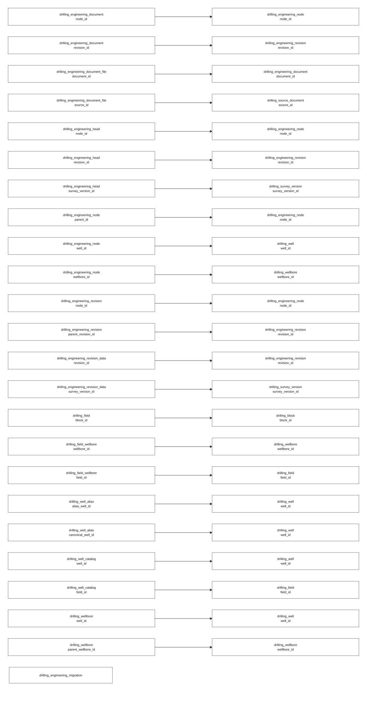

图B-1 工程层级与业务资料物理外键（[draw.io源图](docs/diagrams/database-category-1.drawio)）

### B.2 来源文件与轨迹版本

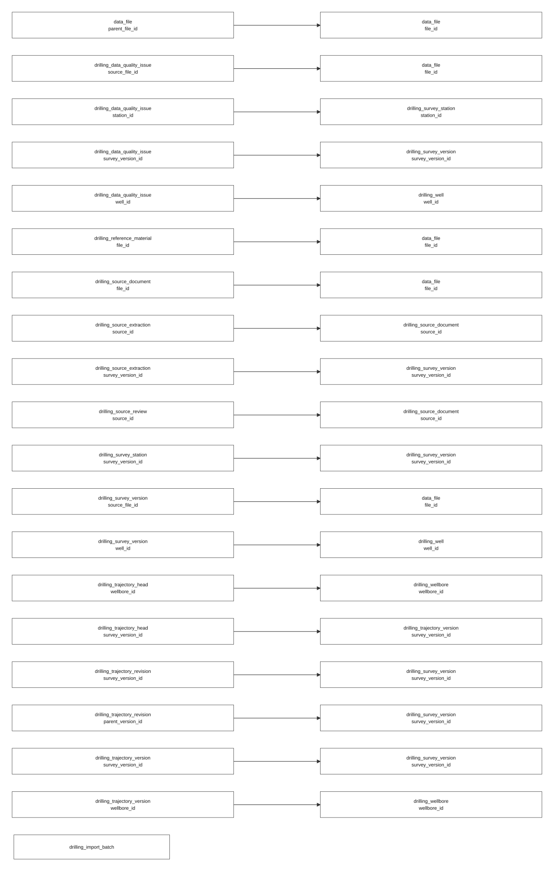

图B-2 来源文件与轨迹版本物理外键（[draw.io源图](docs/diagrams/database-category-2.drawio)）

### B.3 防碰与再规划

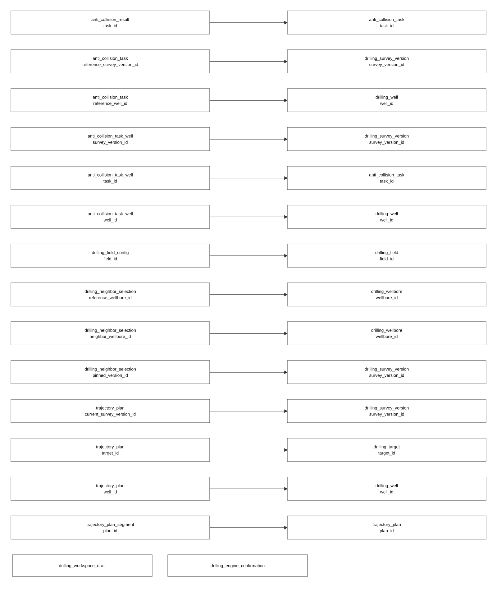

图B-3 防碰与再规划物理外键（[draw.io源图](docs/diagrams/database-category-3.drawio)）

### B.4 实时接入与业务运行

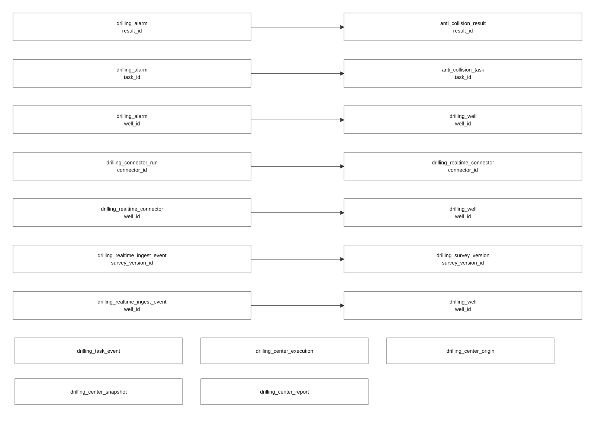

图B-4 实时接入与业务运行物理外键（[draw.io源图](docs/diagrams/database-category-4.drawio)）

### B.5 模型与增量学习

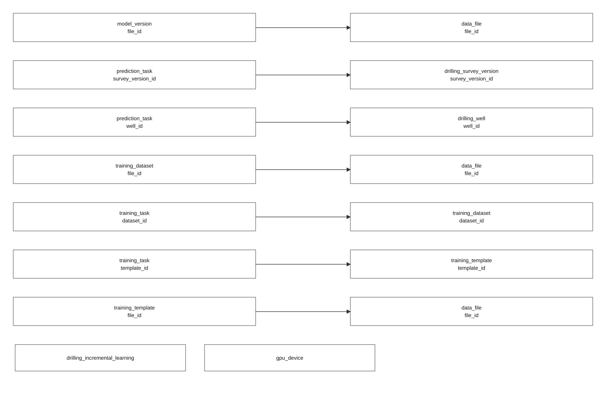

图B-5 模型与增量学习物理外键（[draw.io源图](docs/diagrams/database-category-5.drawio)）

### B.6 账号角色与组织授权

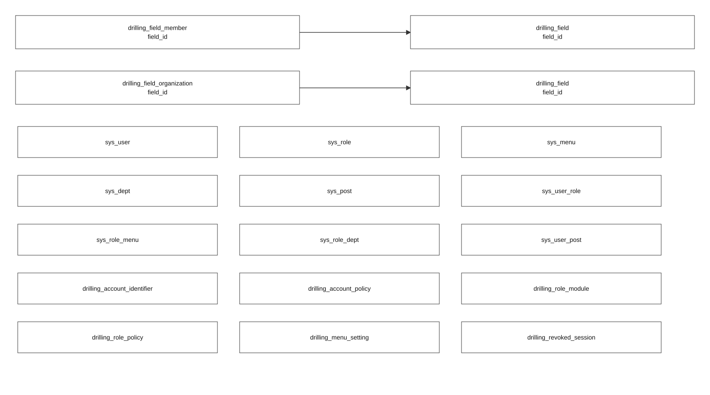

图B-6 账号角色与组织授权物理外键（[draw.io源图](docs/diagrams/database-category-6.drawio)）

### B.7 系统运行与审计

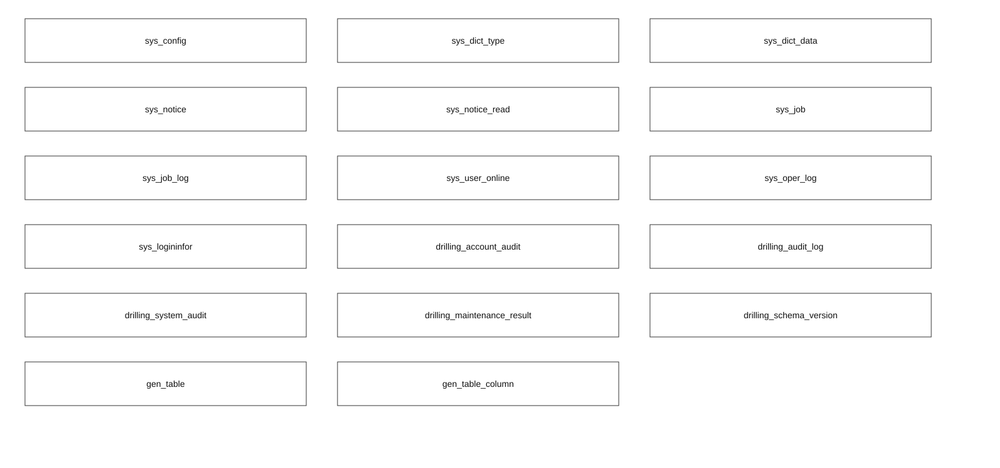

图B-7 系统运行与审计物理外键（[draw.io源图](docs/diagrams/database-category-7.drawio)）

## 附录C 实验、图表与核验材料

算法比较数据来源于提供程序已保存的原实验，包含输入、四种求解器输出和文件摘要。系统A/B/C结果来自当前数据库已执行任务。两者均保留原始数值和状态，不根据需要修改实验结论。

|材料|用途|
|---|---|
|[实验来源与摘要](docs/verification/algorithm/manifest.json)|区分提供的算法实验与系统运行记录|
|[完整数据库结构](docs/verification/database-schema-full.json)|86张表、844个字段及约束的原始结构|
|[系统案例核验](docs/verification/system-test-cases.json)|井眼、版本、导出和增量复用|
|[历史方案快照](docs/verification/planning-history.json)|输入版本与历史结果对应|
|[本次构建和测试](docs/verification/current-validation.json)|实际执行环境与结果|
|[本次交互测试](docs/verification/current-requirements-browser.json)|层级勾选、轨迹依据与强制参数确认|

